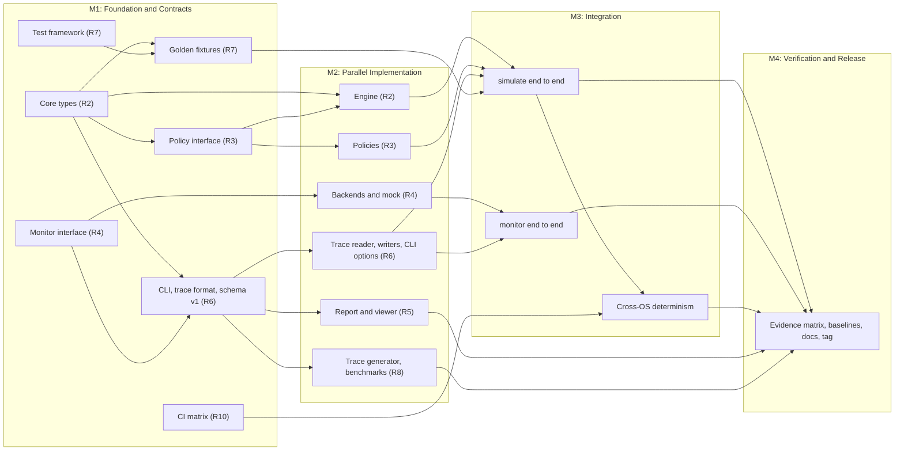

# Contributing

> **Current working split (2026-10-29):** the project currently runs as tracks: **configuration and policies** (roles 2/3 contract side) and **simulation** (trace → engine → live → analytics → compare), with frontend later. Path ownership, the merge-conflict rules and the shared-contract protocol are in [docs/ARCHITECTURE.md section 12](docs/ARCHITECTURE.md#12-ownership-and-merge-conflict-strategy), and agent rules are in [AGENTS.md](AGENTS.md). Where this file disagrees with them, they win. Hardware monitoring (Role 4) is deferred.

The project is built by a ten-person team organised by role. Issues, pull requests, and documents refer to roles by number (Role 1 to Role 10, or R1 to R10). Map people to roles on the GitHub project board, not in these files.

## 1. Team roles

| Role | Title | Owns (paths are created as work lands) |
|---|---|---|
| 1 | Project Lead & Integration | Roadmap, milestones, contract approval, `dev` to `main` merges |
| 2 | C++ Simulation Engine | `include/ccsim/sim/`, `src/sim/` |
| 3 | Cache Algorithms & Replacement Policies | `include/ccsim/policy/`, `src/policy/` |
| 4 | Hardware Monitoring | `include/ccsim/monitor/`, `src/monitor/` |
| 5 | Frontend & Visualization | `src/report/`, `web/` |
| 6 | Backend & API | `include/ccsim/cli.hpp`, `src/cli.cpp`, `src/main.cpp`, `include/ccsim/io/`, `src/io/` |
| 7 | QA & Test Automation | `tests/` layout, fixtures, end-to-end and cross-module tests |
| 8 | Performance & Benchmarking | `bench/`, `tools/tracegen/` |
| 9 | Documentation | `README.md`, `CONTRIBUTING.md`, `docs/` |
| 10 | Build, CI/CD & Release | `CMakeLists.txt`, `cmake/`, `.github/`, `third_party/`, packaging |

Owning a path means reviewing every change to it and being accountable for its quality; anyone may contribute. Module owners write the unit tests for their own modules; Role 7 owns test infrastructure and cross-module tests.

### Role 1: Project Lead & Integration

- **Responsibilities**: milestone plan and backlog, contract approval, cross-role conflicts, module integration, milestone reviews, release decision.
- **Deliverables**: labels, milestones, and branch protection (M1); approved v1 contracts (M1); end-to-end `simulate` and `monitor` with Roles 2, 4, and 6 (M3); release PR and tag (M4).
- **Depends on**: every role's milestone outputs; Role 10's CI as the merge gate.
- **Acceptance**: every issue has one owner role, a milestone, and acceptance criteria; each milestone exit criterion links to evidence; no contract changes outside the protocol in section 2.

### Role 2: C++ Simulation Engine

- **Responsibilities**: core types and config validation, address mapping, cache levels, L1/L2 hierarchy, write-back routing, statistics, AMAT.
- **Deliverables**: `sim/types.hpp` contract (M1); `Hierarchy` and `SimulationResult` with unit tests (M2); golden demos passing end to end (M3).
- **Depends on**: Role 3's policy *interface* (use a stub policy until the implementations land); Role 6's trace reader only for end-to-end runs.
- **Acceptance**: TECHNICAL_DESIGN sections 4 to 6 implemented exactly; Demos A to C reproduce every integer; invariants tested; no OS headers in `src/sim/`.

### Role 3: Cache Algorithms & Replacement Policies

- **Responsibilities**: `ReplacementPolicy` contract; LRU, FIFO, and Random; deterministic RNG; policy factory; policy-level tests.
- **Deliverables**: interface (M1); three policies with tests, including the Belady sequence (M2).
- **Depends on**: Role 2's core types (`PolicyKind`).
- **Acceptance**: Demo C exact; Random identical across OSes for a fixed seed with no `std::uniform_int_distribution`; per-access cost no worse than O(ways).

### Role 4: Hardware Monitoring

- **Responsibilities**: `MonitorBackend` contract, metric catalogue, availability semantics; Linux, Windows, and macOS backends; mock backend; interval sampler; platform research and evidence.
- **Deliverables**: interface (M1); mock backend and sampler, Linux `perf_event_open` backend, Windows cycle-time backend plus ETW feasibility report, macOS `proc_pid_rusage` backend (M2); per-OS evidence runs (M3).
- **Depends on**: Role 6's output schema; Role 10's platform-conditional build; Role 7's `hardware` test label.
- **Acceptance**: all five availability values exercised by mock tests on every OS; unavailable metrics never emitted as 0; probe output on each tested machine matches TECHNICAL_DESIGN section 8.

### Role 5: Frontend & Visualization

- **Responsibilities**: human-readable console report; static offline viewer for results JSON (simulation statistics, AMAT breakdown, monitoring time series).
- **Deliverables**: report formatter and `web/` viewer working from sample files (M2), then from real outputs (M3).
- **Depends on**: Role 6's schema v1 and sample outputs (M1 contract).
- **Acceptance**: the viewer opens offline from a file picker in current Chrome, Firefox, Edge, and Safari with no network requests; unavailable metrics show `n/a` and the reason; the console report fits 80 columns.

### Role 6: Backend & API

- **Responsibilities**: CLI parsing and dispatch, cache-spec parsing, trace reader, JSON and CSV writers, library API surface, error messages, exit codes, Windows path encoding.
- **Deliverables**: CLI syntax, trace format v1, schema v1 with sample files (M1); trace reader, writers, `simulate` options (M2); end-to-end wiring with Role 1 (M3).
- **Depends on**: Role 2's core types; Role 4's metric catalogue.
- **Acceptance**: malformed input gives `<file>:<line>: <message>` and exit code 1; outputs validate against schema v1; every feature is usable through the library without the CLI.

### Role 7: QA & Test Automation

- **Responsibilities**: test framework and layout, golden fixtures, invariant and determinism tests, mock-based monitoring tests, sanitizer runs, validation evidence.
- **Deliverables**: vendored doctest with the smoke test migrated, golden fixtures from WORKING_DEMO (M1); invariant tests over generated traces (M2); cross-OS determinism check (M3); evidence for the platform matrix (M4).
- **Depends on**: Role 10's CI; contracts from Roles 2, 3, 4, and 6.
- **Acceptance**: the default suite is deterministic (no sleeps, hardware, or unseeded randomness) and green on all three OSes; every bug fix has a regression test.

### Role 8: Performance & Benchmarking

- **Responsibilities**: synthetic trace generator, simulator throughput benchmarks, working-set microbenchmarks for monitoring sanity checks, performance baselines.
- **Deliverables**: seeded trace generator with sequential, strided, random, and loop patterns (M2); benchmark harness under the opt-in `bench` label (M2); baseline report (M4).
- **Depends on**: Role 6's trace format; Role 2's engine; Role 4's monitor for microbenchmark validation.
- **Acceptance**: benchmarks run only in Release and only on request; every result records CPU, OS, compiler, and flags; repeated runs stay within a stated variance.

### Role 9: Documentation

- **Responsibilities**: accurate, consistent docs; status labels; platform matrix; CLI user documentation; documentation review of every behaviour-changing PR.
- **Deliverables**: docs synced to merged contracts (M1); per-feature docs (M2, M3); verified WORKING_DEMO and final matrix (M4); release notes with Role 1.
- **Depends on**: evidence from Roles 7 and 10 and from module owners.
- **Acceptance**: every documented command is verified on the stated OS or labelled Not tested; links resolve; nothing is labelled Implemented without merged tests.

### Role 10: Build, CI/CD & Release

- **Responsibilities**: CMake structure, options, warning policy; CI matrix; formatting and portability checks; dependency vendoring; packaging and versioning.
- **Deliverables**: CI on Linux (GCC, Clang), Windows (MSVC), and macOS (Apple Clang) (M1); `.clang-format`, `.gitattributes`, and checks (M1); sanitizer job (M2); release archives and SemVer tags (M4).
- **Depends on**: Role 7's test labels; Role 1's branch rules.
- **Acceptance**: CI is required for merges into `dev` and `main`; a clean checkout builds with the documented commands on all three OSes; release artifacts are reproducible from a tag.

## 2. Shared interfaces and ownership boundaries

| Contract | Location | Owner | Consumers |
|---|---|---|---|
| Core types and `validate()` | `include/ccsim/sim/types.hpp` | Role 2 | 3, 5, 6, 7, 8 |
| `ReplacementPolicy`, `make_policy` | `include/ccsim/policy/replacement_policy.hpp` | Role 3 | 2, 7 |
| `MonitorBackend`, metric catalogue, `Availability` | `include/ccsim/monitor/backend.hpp` | Role 4 | 5, 6, 7 |
| Trace format v1 | TECHNICAL_DESIGN section 7 | Role 6 | 2, 7, 8 |
| CLI syntax and exit codes | TECHNICAL_DESIGN section 10, `include/ccsim/cli.hpp` | Role 6 | 1, 5, 7, 9 |
| Results schema v1 and sample files | TECHNICAL_DESIGN section 11 | Role 6 | 5, 7, 8, 9 |
| CMake targets and options | `CMakeLists.txt` (modules add sources via their own `src/<module>/CMakeLists.txt`) | Role 10 | All |
| Contract extension 1.1 (inclusion, write policies) | `include/ccsim/sim/types.hpp`, ARCHITECTURE section 5.2 | Shared, append-only | All |
| Engine event stream and C ABI | `include/ccsim/sim/events.hpp`, `include/ccsim/wasm/ccsim_api.h` | Simulation track | Frontend |
| Standard dataset | `tests/data/standard/` | Simulation track | All (read-only) |

Rules:

1. Contracts are frozen at the end of M1. Afterwards a change needs an issue labelled `contract`, approval from Role 1 and every consuming role in the PR, and the matching TECHNICAL_DESIGN update in the same PR. Breaking changes bump the contract or schema version.
2. Consumers code against interfaces, stubs, and mocks, never against another module's internals. No `#include` of another module's `src/` headers.
3. OS-specific code lives only under `src/monitor/<os>/`.

## 3. Milestone plan

> **Historical.** This plan predates the move to a website with a WebAssembly engine (CLI-first, hardware monitoring, three-OS release). The current roadmap is [ARCHITECTURE.md section 17](docs/ARCHITECTURE.md#17-roadmap-and-open-decisions); the roles, review and Git rules in the other sections still apply where ARCHITECTURE section 12 does not override them.



| Milestone | Goal | Exit criteria |
|---|---|---|
| M1 Foundation and Contracts | Everyone can work in parallel against frozen interfaces | CI green on all three OSes; contract headers compile everywhere; trace format, CLI syntax, and schema v1 with sample files merged; golden fixtures reviewed by Roles 2, 3, and 7; branch protection active |
| M2 Parallel Implementation | Every module complete and unit-tested in isolation | Module tests pass on all three OSes using stubs and mocks; Windows ETW decision recorded; status labels updated per feature |
| M3 Integration | Both commands work end to end | Demos A to C pass end to end with identical integer results on all three OSes; `monitor` passes with the mock everywhere and with the real backend on at least one machine per OS where hardware allows; viewer loads real outputs |
| M4 Verification and Release | An evidence-backed release | Platform matrix filled from recorded evidence; baselines recorded; WORKING_DEMO acceptance criteria AC-1 to AC-10 met or waived in writing by Role 1; release tagged on `main` |

**Independent work.** M1-02, M1-04, M1-05, and M1-07 have no prerequisites and can start immediately. Within M2, tracks are independent once M1 contracts land: Role 2 uses a stub policy until M2-03 merges, Role 5 builds against the M1 sample files, Role 4 develops against the mock backend, and Role 8's generator needs only the trace format.

**Critical path.** M1-05 → M1-06 → M2-01 → M2-02 → M3-01 → M3-03 → M4-01 → M4-04 → M4-05.

## 4. Suggested GitHub Issues

Suggested labels: `milestone:M1` to `milestone:M4`, `role:R1` to `role:R10`, `type:feature|test|docs|ci|contract`, `os:linux|windows|macos`.

| ID | Title | Role | Depends on |
|---|---|---|---|
| M1-01 | Branch protection for `main` and `dev`, labels, milestones, `dev` as default branch | 1 | Repository created |
| M1-02 | CI matrix: build and `ctest` on Linux (GCC, Clang), Windows (MSVC), macOS (Apple Clang); warnings as errors | 10 | none |
| M1-03 | `.clang-format`, `.gitattributes` (LF), format check, lint for OS headers outside `src/monitor/` | 10 | M1-02 |
| M1-04 | Vendor a pinned doctest; migrate the smoke test | 7 | none |
| M1-05 | Contract: core types and `validate()` | 2 | none |
| M1-06 | Contract: `ReplacementPolicy` and `make_policy` | 3 | M1-05 |
| M1-07 | Contract: `MonitorBackend`, metric catalogue, `Availability` | 4 | none |
| M1-08 | Contract: CLI syntax, trace format v1, results schema v1, sample JSON and CSV files | 6 | M1-05, M1-07 |
| M1-09 | Golden fixtures: Demo A to C traces and expected results as test data | 7 (review 2, 3) | M1-04, M1-05 |
| M1-10 | Sync TECHNICAL_DESIGN with the merged contracts | 9 | M1-05 to M1-08 |
| M2-01 | Address mapping and single-level cache (invalid-first fill, write-back, write-allocate) | 2 | M1-05, M1-06 |
| M2-02 | Two-level hierarchy: write-back routing, statistics, exact AMAT | 2 | M2-01 |
| M2-03 | LRU, FIFO, Random policies with deterministic RNG | 3 | M1-06 |
| M2-04 | Trace reader v1: line-numbered errors, CRLF support | 6 | M1-08 |
| M2-05 | `simulate` options: cache-spec parsing, defaults, exit codes | 6 | M1-08 |
| M2-06 | JSON and CSV writers for schema v1 | 6 | M1-08 |
| M2-07 | Mock backend and `IntervalSampler` with injected time | 4 | M1-07 |
| M2-08 | Linux backend: `perf_event_open`, errno mapping, multiplexing scaling | 4 | M1-07 |
| M2-09 | Windows backend: `QueryProcessCycleTime`; ETW PMU feasibility report | 4 | M1-07 |
| M2-10 | macOS backend: `proc_pid_rusage` cycles and instructions with advancing-counter probe | 4 | M1-07 |
| M2-11 | Console report formatter | 5 | M1-08 |
| M2-12 | Offline web viewer (file picker, no network) | 5 | M1-08 |
| M2-13 | Seeded synthetic trace generator | 8 | M1-08 |
| M2-14 | Throughput benchmarks and working-set sweep (`bench` label, Release only) | 8 | M2-02 |
| M2-15 | Sanitizer CI job; MSVC AddressSanitizer option | 10 | M1-02 |
| M2-16 | Invariant tests over generated traces | 7 | M1-09, M2-02, M2-13 |
| M2-17 | Mock monitoring tests: every availability value, scaling, partial intervals | 7 | M2-07 |
| M3-01 | End-to-end `ccsim simulate` with Demo A to C tests | 1 with 2, 6 | M2-02 to M2-06 |
| M3-02 | End-to-end `ccsim monitor` including `--probe` and process launch | 1 with 4, 6 | M2-06 to M2-10 |
| M3-03 | Cross-OS determinism check in CI (identical integer results) | 7 | M1-02, M3-01 |
| M3-04 | Report and viewer on real outputs | 5 | M3-01, M3-02 |
| M3-05 | Hardware evidence runs per OS (probe and run logs) | 4 with 7 | M3-02 |
| M3-06 | Verify every documented command against the build | 9 | M3-01, M3-02 |
| M4-01 | Fill the platform validation matrix from evidence | 9 with 7 | M3-03, M3-05 |
| M4-02 | Performance baselines and regression thresholds | 8 | M2-14, M3-01 |
| M4-03 | Release packaging (CPack archives per OS) | 10 | M3-01 |
| M4-04 | Acceptance review of AC-1 to AC-10 | 7 with 1 | M4-01, M3-04 |
| M4-05 | Release: merge `dev` into `main`, tag, release notes | 1 with 9, 10 | M4-02, M4-03, M4-04 |

## 5. Collaboration rules

- Work starts from an issue with one owner role, a milestone, and acceptance criteria.
- Open a draft PR early. Keep PRs focused, ideally under 400 changed lines excluding fixtures and vendored code.
- Record decisions in the issue or PR; the module owner decides inside a module and Role 1 decides across modules.
- Change a status label (Planned, Partially implemented, Implemented; Verified, Not tested) only in the PR that provides the code, tests, or evidence.
- Never commit secrets, binaries, generated results, or large datasets. Test traces stay small, textual, and reviewed. Two documented exceptions: the standard dataset `tests/data/standard/matmul64-O0.trace.gz` (1.2 MB, checksum-pinned), and the curated evidence files listed in `tests/results/README.md`.
- Review requests get a response within two working days; if blocked, ask the owning role, then Role 1.

## 6. Git workflow

| Branch | Purpose | Rules |
|---|---|---|
| `main` | Stable releases | Protected; receives release PRs from `dev` and hotfixes only; tagged `vMAJOR.MINOR.PATCH` |
| `dev` | Integration | Protected; PRs only; CI must pass |
| `feat/<name>` | Features | Branch from `dev`, PR into `dev` |
| `test/<name>` | Tests and fixtures | Branch from `dev`, PR into `dev` |
| `docs/<name>` | Documentation | Branch from `dev`, PR into `dev` |
| `ci/<name>` | Build, CI, release tooling | Branch from `dev`, PR into `dev` |
| `fix/<name>` | Bug fixes (added to the proposed set) | From `dev`; hotfixes branch from `main`, PR into `main`, then merge `main` back into `dev` |

Use lowercase, hyphenated names that start with the issue number, for example `feat/42-lru-policy`. After the first commit on `main`, create `dev` from it and make `dev` the default branch so new PRs target it automatically.

```bash
git switch dev && git pull --ff-only
git switch -c feat/42-lru-policy
# edit, build, test
cmake --build build && ctest --test-dir build --output-on-failure
git commit -m "feat(policy): add LRU replacement"
git push -u origin feat/42-lru-policy        # then open a PR with base: dev
```

- Rebase onto `origin/dev` before requesting review; once review has started, merge `dev` into the branch instead so review history survives.
- Feature PRs are squash-merged into `dev`. Release PRs from `dev` into `main` use a merge commit, and the tag goes on `main`.
- Commit messages and squash titles follow Conventional Commits: `feat`, `fix`, `test`, `docs`, `ci`, `build`, `refactor`, `chore`, with the module as scope.

## 7. Pull request reviews

To merge into `dev`:

- CI green on every OS job (from M1-02; until then the author pastes local `ctest` output and names the OS and compiler).
- At least one approval from the owning role of each touched path. Contract changes need Role 1 and every consuming role; CMake and CI changes need Role 10.
- All review conversations resolved.

To merge into `main`: Roles 1 and 10 approve, and the release checklist (M4-05) is complete.

PR description checklist:

- [ ] Linked issue; its acceptance criteria are met
- [ ] Tests added or updated; `ctest` passes locally (OS and compiler stated)
- [ ] No new warnings with `-DCCSIM_WARNINGS_AS_ERRORS=ON`
- [ ] Docs and status labels updated, or "no docs impact" stated
- [ ] Platform differences documented; OS-specific code only under `src/monitor/<os>/`

Reviewers check correctness against TECHNICAL_DESIGN, determinism, portability, honest reporting (no invented values), and test quality, in that order.

## 8. Testing standards

- **Coverage of change**: every behaviour change ships with tests in the same PR; every bug fix adds a regression test.
- **Deterministic simulation tests**: fixed traces and seeds; no clocks, threads, sleeps, network, or files outside `tests/data/`. Integer counters are compared exactly; floating-point values with a relative tolerance of 1e-9. Expected values come from an independent derivation (hand trace or reference model), not from copying the implementation's output. The exception is seeded Random results, which are pinned after M3-03 shows all three OSes agree.
- **Mocked monitoring tests**: run by default on every OS through the mock backend and must cover every availability value, multiplexing scaling, and partial intervals.
- **Hardware tests**: labelled `hardware`, excluded from CI (`ctest -LE hardware`), and exit with code 77 when counters are unavailable. Registered with the CTest property `SKIP_RETURN_CODE 77`, they show as skipped, never as passed.
- **OS-specific validation**: run hardware tests manually on each OS where possible. Record OS version, CPU model, kernel or build number, privilege level, and output in the PR; Role 9 updates the README matrix only from such evidence.
- **Naming and labels**: tests are named `<area>.<behaviour>` (for example `sim.writeback_routing`); labels are `smoke`, `unit`, `golden`, `stress`, `dataset`, `bench` (opt-in), plus `e2e` and `hardware` when those suites exist.
- **Assertions**: use the checks in `tests/support/harness.hpp` (`CHECK`, `CHECK_EQ`, `CHECK_NEAR`, `CHECK_THROWS_AS`), never `assert()`, which Release builds remove. Doctest (M1-04) may replace the harness later without changing test bodies much.
- **Sanitizers**: the ASan and UBSan job stays green once M2-15 lands.
- **Fixtures**: text files under 100 KB with a header comment that states their purpose and where the expected results come from.

## 9. Coding standards

- ISO C++17, no compiler extensions, namespace `ccsim`. Types `PascalCase`; functions and variables `snake_case`; constants `kPascalCase`.
- Headers are `.hpp` under `include/ccsim/<module>/` with `#pragma once`; sources are `.cpp` under `src/<module>/`.
- Fixed-width integers for addresses and counters; no `long`.
- No OS headers outside `src/monitor/<os>/`; no global mutable state.
- Invalid configuration or input throws an exception derived from `std::runtime_error`; monitoring availability is reported as data.
- Formatting follows `.clang-format` from M1-03; until then match the existing style (4-space indent, about 100 columns).

## 10. Definition of Done

A change is done when all of the following hold:

1. It is merged into `dev` through a PR with the required approvals.
2. CI is green on Linux, Windows, and macOS (once CI exists).
3. Deterministic tests cover it and pass in both Debug and Release.
4. It builds warning-free with `CCSIM_WARNINGS_AS_ERRORS=ON`.
5. Docs, status labels, and the platform matrix where relevant are updated, with evidence behind every Verified.
6. The issue's acceptance criteria are demonstrably met (linked test, CI run, or recorded output).
7. Platform differences and limitations introduced by the change are documented.
8. It introduces no unverified claim: anything not executed on an OS is labelled Not tested.
