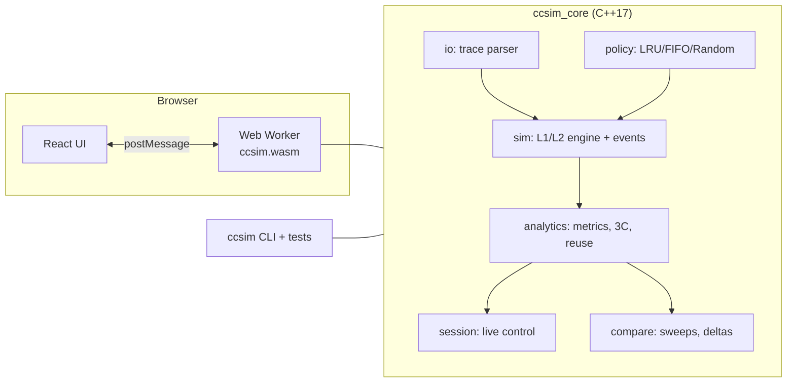

# CPU Cache Simulator (`ccsim`)

A deterministic **L1/L2 cache simulator** written in portable C++17 and delivered as a **website**: configure a hierarchy, upload a memory trace, watch every access live, analyse the run, and benchmark configurations against each other. The engine compiles to WebAssembly and runs in the visitor's browser.

> **Status: v0.1.0, engine phase.** The simulation engine, the production LRU / FIFO / Random replacement policies, live-session API, analytics, comparison, browser C ABI, test suites and the validated standard dataset are **Implemented** as library code (Linux-verified). `validate()` (configuration track), the `simulate` CLI command and the web UI are **Planned**. Hardware monitoring is **Deferred**.
>
> **New here? Read [docs/ARCHITECTURE.md](docs/ARCHITECTURE.md).** Contributors and AI agents: read [AGENTS.md](AGENTS.md). Latest QA pass: [QA_REPORT.md](QA_REPORT.md).

## Features

| Feature | Status |
|---|---|
| L1 + optional L2: size, line size, associativity, hit latency, memory latency | Implemented (engine) |
| Inclusive / exclusive / non-inclusive L2; write-back / write-through; write-allocate / no-write-allocate | Implemented (engine, contract 1.1) |
| Replacement policies LRU, FIFO, seeded Random | Implemented (configuration track, `src/policy/`) |
| Trace format v1 (`.trace`, `.trace.gz` in the browser), streaming parser with line-numbered errors | Implemented |
| Live simulation API: step, run to breakpoint, seek, reset, per-access action log | Implemented (engine); UI Planned |
| Analytics: hit/miss rates, AMAT and its exact breakdown, 3C classification, reuse distance and miss-ratio curve, set heatmaps, timeline | Implemented (engine); charts Planned |
| Comparison: parameter sweeps, per-metric deltas and winner, JSON / CSV / text log | Implemented (engine); views Planned |
| WebAssembly C ABI for the website | Implemented and tested natively; Emscripten build Not tested |
| `ccsim simulate` CLI command | Planned |
| Hardware monitoring (`ccsim monitor`) | Deferred |

## Technology stack

- **Engine:** ISO C++17 and the standard library, with no runtime dependencies; CMake 3.20+ and CTest
- **Browser:** the same engine compiled with Emscripten to WebAssembly, running in a Web Worker
- **Website (Planned):** React 18 + TypeScript + Vite, Apache ECharts, canvas grids; static hosting on Cloudflare Pages
- **Why not a Python/FastAPI backend:** see [ARCHITECTURE.md section 4](docs/ARCHITECTURE.md#4-the-api-decision-webassembly-in-a-web-worker-not-fastapi)
- No server-side compute; traces never leave the user's machine

## Architecture



Full design, ownership and the merge-conflict strategy: [docs/ARCHITECTURE.md](docs/ARCHITECTURE.md).

## Repository structure

Owner tags: **[shared]** append-only contract, **[config]** configuration track, unmarked = simulation track. `(Planned)` paths do not exist yet. Layering rules: [ARCHITECTURE.md section 11](docs/ARCHITECTURE.md#11-repository-structure-and-layering).

```text
CacheSim/
├── README.md                       this file: overview, structure, quick start, status
├── AGENTS.md                       [shared] binding rules for AI agents and contributors
├── CONTRIBUTING.md                 roles, Git workflow, reviews, Definition of Done
├── QA_REPORT.md                    repository QA report: latest test completion report
├── CMakeLists.txt                  [shared] options; auto-discovers src/<module>/CMakeLists.txt
├── .gitattributes  .gitignore      LF line endings; whitelist for tests/results/
├── .github/workflows/ci.yml        push/PR + nightly: dataset checksum, GCC/Clang/ASan suites, WASM + Node smoke, bench
├── docs/                           ARCHITECTURE [shared] · TECHNICAL_DESIGN · FRONTEND_DESIGN · WORKING_DEMO · DEVELOPMENT · OVERVIEW
├── assets/images/                  UI mood-board screenshots
├── include/ccsim/                  public headers, one folder per module
│   ├── sim/                        types.hpp [shared] contract 1.1 (config, stats, enums, policy name table)
│   │                               · geometry · line_index · cache_level · events · hierarchy
│   ├── policy/                     [config] replacement_policy.hpp: ReplacementPolicy, make_policy
│   ├── config/                     [config] (Planned) validate(), spec parsing, presets
│   ├── io/                         trace.hpp: streaming parser, compact Trace storage
│   ├── analytics/                  metrics · miss_classifier (3C) · reuse (distance, miss-ratio curve)
│   ├── session/                    session.hpp: step / run / seek / reset, batch runner
│   ├── report/                     json.hpp: ccsim.simulation/1 and ccsim.events/1 writers
│   ├── compare/                    compare.hpp: sweeps, deltas, JSON / CSV / log
│   ├── wasm/                       ccsim_api.h: C ABI for the browser
│   └── cli.hpp
├── src/                            one folder per module, each with *.cpp + its own CMakeLists.txt
│   ├── io/ sim/ analytics/ session/ report/ compare/
│   ├── policy/                     [config] production LRU, FIFO, Random + make_policy
│   ├── config/                     [config] (Planned) validate(), spec parsing, presets
│   ├── wasm/                       ccsim_api.cpp (C ABI) + wasm_main.cpp (Emscripten target, built only under emcc)
│   └── cli.cpp  main.cpp           the ccsim executable
├── tests/
│   ├── CMakeLists.txt              suites discovered by glob; labels smoke/unit/golden/stress/dataset/bench
│   ├── support/                    harness, fixtures, reference policies (TEST-ONLY, never shipped)
│   ├── smoke/                      CLI contract
│   ├── unit/                       per-module, edge-case and boundary tests (test_policy_*, test_config_* are [config])
│   ├── golden/                     WORKING_DEMO Demos A–C, hand-derived expectations
│   ├── stress/                     invariants (72 configs × 1M accesses) · production vs reference · differential oracle
│   ├── dataset/                    standard dataset integrity, regression baselines, fitness report
│   ├── bench/                      throughput benchmarks (opt-in)
│   ├── wasm/smoke.mjs              loads the Emscripten module in Node, checks the ABI on Demo B
│   ├── data/golden/                demo_a_conflict / demo_b_two_level / demo_c_belady .trace
│   ├── data/standard/              matmul64-O0.trace.gz (pinned, never modify) + matmul.c + manifest
│   └── results/                    generated evidence; only the files in its README are committed
└── web/                            (Planned) React + TypeScript frontend, frontend track
```

## Quick start

Install a compiler and CMake 3.20+ first ([docs/DEVELOPMENT.md](docs/DEVELOPMENT.md#2-prerequisites)).

Linux and macOS:

```bash
cmake -S . -B build -DCMAKE_BUILD_TYPE=Release
cmake --build build
ctest --test-dir build --output-on-failure      # smoke, unit, golden, stress, dataset
./build/ccsim --version
```

Windows (PowerShell, Visual Studio 2022):

```powershell
cmake -S . -B build
cmake --build build --config Release
ctest --test-dir build -C Release --output-on-failure
.\build\Release\ccsim.exe --version
```

## Implementation status

Feature status is in the [Features](#features) table. Roadmap: [ARCHITECTURE.md section 17](docs/ARCHITECTURE.md#17-roadmap-and-open-decisions). Ownership: [ARCHITECTURE.md section 12](docs/ARCHITECTURE.md#12-ownership-and-merge-conflict-strategy).

### Platform validation matrix

**Verified**: executed successfully with recorded evidence. **Partially supported**: works with documented restrictions. **Unsupported**: not available on that platform in v1, by OS limitation or design. **Not tested**: not yet executed there.

| Capability | Linux | Windows | macOS |
|---|---|---|---|
| Configure, build, smoke tests | Verified [1] | Not tested [2] | Not tested |
| Cache simulation engine (library, all test suites) | Verified [7] | Not tested | Not tested |
| WebAssembly build | Not tested | Not tested | Not tested |
| Monitoring: cycles, instructions | Not tested (Planned) | Not tested (Planned) [3] | Not tested (Planned) |
| Monitoring: L1D loads and misses | Not tested (Planned) | Not tested (Planned) [4] | Unsupported [5] |
| Monitoring: L2 accesses and misses | Not tested (Planned) [6] | Not tested (Planned) [4] | Unsupported [5] |
| Monitoring: last-level cache | Not tested (Planned) | Not tested (Planned) [4] | Unsupported [5] |

1. Ubuntu 24.04 x86-64: GCC 13.3 and Clang 18.1 (libstdc++ and libc++); Release and Debug; Makefiles and Ninja Multi-Config; ASan and UBSan; CMake 3.20.5 and 3.28.3; warnings as errors.
2. Cross-compiled with MinGW-w64 GCC 13 to Windows x86-64 executables (not run). MSVC not tested.
3. Without elevation, v1 reports OS-accounted `os_cycle_time`, not PMU cycles. PMU cycles and instructions need an elevated ETW session (feasibility spike in Milestone 2).
4. Possible only through ETW PMU sources: elevated, CPU-specific, custom events since Windows 10 1903.
5. Cache events are exposed only through Instruments' CPU Counters (full Xcode). v1 documents that manual workflow instead of automating it.
6. `perf_event_open` has no generic L2 event; CPU-specific raw event codes are required.
7. 2026-10-31, Kali rolling x86-64: GCC 16.2 Release, GCC Debug with ASan + UBSan, Clang 21.1 Release; CMake 4.4 + Ninja; warnings as errors; all suites green ([tests/results/](tests/results/), [QA_REPORT.md](QA_REPORT.md)).

Monitoring rows below are **Deferred** and kept for the record.

Hardware counters were not validated anywhere yet: the validation VM exposes no PMU (hardware events fail with `ENOENT`). See [TECHNICAL_DESIGN.md section 8.3](docs/TECHNICAL_DESIGN.md#83-linux).

## Documentation

| Document | Contents |
|---|---|
| [docs/ARCHITECTURE.md](docs/ARCHITECTURE.md) | **Start here.** The whole system: API decision, cache model, live simulation, analytics, comparison, layout, ownership, performance, deployment |
| [AGENTS.md](AGENTS.md) | Rules for AI agents and contributors |
| [QA_REPORT.md](QA_REPORT.md) | Latest QA pass: methods, results, defects and fixes, architecture conformance, open risks |
| [tests/data/standard/README.md](tests/data/standard/README.md) | The standard benchmark dataset: manifest, fitness evidence, profiles |
| [docs/TECHNICAL_DESIGN.md](docs/TECHNICAL_DESIGN.md) | Exact v1 rules: cache model, trace format, statistics, interfaces (monitoring deferred) |
| [docs/DEVELOPMENT.md](docs/DEVELOPMENT.md) | Per-OS prerequisites, build, test, debug, troubleshooting |
| [docs/WORKING_DEMO.md](docs/WORKING_DEMO.md) | Walkthroughs, sample traces, expected results, acceptance criteria |
| [docs/FRONTEND_DESIGN.md](docs/FRONTEND_DESIGN.md) | Web UI views and layout |
| [CONTRIBUTING.md](CONTRIBUTING.md) | Roles, milestones, issues, Git workflow, reviews, testing, Definition of Done |

## License

No license has been chosen yet. Until a `LICENSE` file is added, default copyright applies and the code is not open source.
