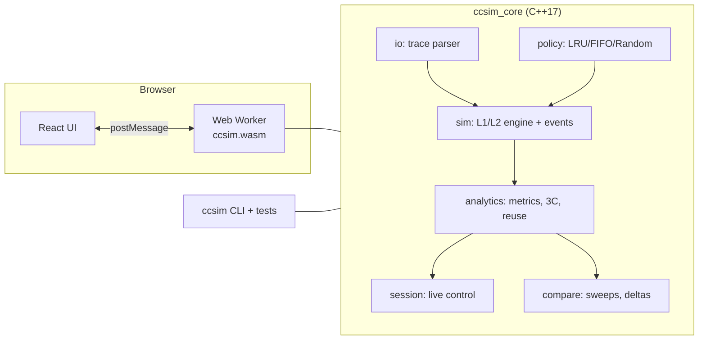

# CPU Cache Simulator (`ccsim`)

A deterministic **L1/L2 cache simulator** written in portable C++17 and delivered as a **website**: configure a hierarchy, upload a memory trace, watch every access live, analyse the run, and benchmark configurations against each other. The engine compiles to WebAssembly and runs in the visitor's browser.

> **Status: v0.1.0, engine phase.** The simulation engine, the production LRU / FIFO / Random replacement policies, live-session API, analytics, comparison, browser C ABI, test suites, the validated standard dataset and the website (React + WebAssembly) are **Implemented** and Linux-verified. `validate()` (configuration track) and the `simulate` CLI command are **Planned**. Hardware monitoring is **Deferred**.
>
> **New here? Read [docs/ARCHITECTURE.md](docs/ARCHITECTURE.md).** Contributors and AI agents: read [AGENTS.md](AGENTS.md). Latest QA pass: [QA_REPORT.md](QA_REPORT.md).

## Features

| Feature | Status |
|---|---|
| L1 + optional L2: size, line size, associativity, hit latency, memory latency | Implemented (engine) |
| Inclusive / exclusive / non-inclusive L2; write-back / write-through; write-allocate / no-write-allocate | Implemented (engine, contract 1.1) |
| Replacement policies LRU, FIFO, seeded Random | Implemented (configuration track, `src/policy/`) |
| Trace format v1 (`.trace`, `.trace.gz` in the browser), streaming parser with line-numbered errors | Implemented |
| Live simulation API: step, run to breakpoint, seek, reset, per-access action log | Implemented (engine and website) |
| Analytics: hit/miss rates, AMAT and its exact breakdown, 3C classification, reuse distance and miss-ratio curve, set heatmaps, timeline | Implemented (engine and website) |
| Comparison: parameter sweeps, per-metric deltas and winner, JSON / CSV / text log | Implemented (engine and website) |
| WebAssembly C ABI for the website | Implemented; Emscripten build verified on Linux |
| `ccsim simulate` CLI command | Planned |
| Hardware monitoring (`ccsim monitor`) | Deferred |

## Technology stack

- **Engine:** ISO C++17 and the standard library, with no runtime dependencies; CMake 3.20+ and CTest
- **Browser:** the same engine compiled with Emscripten to WebAssembly, running in a Web Worker
- **Website:** React 18 + TypeScript + Vite, Apache ECharts, canvas grids; static hosting on Cloudflare Pages
- **Why not a Python/FastAPI backend:** see [ARCHITECTURE.md section 4](docs/ARCHITECTURE.md#4-the-api-decision-webassembly-in-a-web-worker-not-fastapi)
- No server-side compute; traces never leave the user's machine

## Architecture



Full design, ownership and the merge-conflict strategy: [docs/ARCHITECTURE.md](docs/ARCHITECTURE.md).

## Repository structure

Owner tags: **[shared]** append-only contract, **[config]** configuration track, unmarked = simulation track. `(Planned)` paths do not exist yet. Layering rules: [ARCHITECTURE.md section 11](docs/ARCHITECTURE.md#11-repository-structure-and-layering).

```text
CacheSim/
├── README.md                       this file: overview, structure, quick start, status
├── AGENTS.md                       [shared] binding rules for AI agents and contributors
├── CONTRIBUTING.md                 roles, Git workflow, reviews, Definition of Done
├── QA_REPORT.md                    repository QA report: latest test completion report
├── CMakeLists.txt                  [shared] options; auto-discovers src/<module>/CMakeLists.txt
├── .gitattributes  .gitignore      LF line endings; whitelist for tests/results/
├── .github/workflows/ci.yml        push/PR + nightly: dataset checksum, GCC/Clang/ASan suites, WASM + Node smoke, bench
├── docs/                           ARCHITECTURE [shared] · TECHNICAL_DESIGN · FRONTEND_DESIGN · WORKING_DEMO · DEVELOPMENT · OVERVIEW
├── assets/images/                  UI mood-board screenshots
├── include/ccsim/                  public headers, one folder per module
│   ├── sim/                        types.hpp [shared] contract 1.1 (config, stats, enums, policy name table)
│   │                               · geometry · line_index · cache_level · events · hierarchy
│   ├── policy/                     [config] replacement_policy.hpp: ReplacementPolicy, make_policy
│   ├── config/                     [config] (Planned) validate(), spec parsing, presets
│   ├── io/                         trace.hpp: streaming parser, compact Trace storage
│   ├── analytics/                  metrics · miss_classifier (3C) · reuse (distance, miss-ratio curve)
│   ├── session/                    session.hpp: step / run / seek / reset, batch runner
│   ├── report/                     json.hpp: ccsim.simulation/1 and ccsim.events/1 writers
│   ├── compare/                    compare.hpp: sweeps, deltas, JSON / CSV / log
│   ├── wasm/                       ccsim_api.h: C ABI for the browser
│   └── cli.hpp
├── src/                            one folder per module, each with *.cpp + its own CMakeLists.txt
│   ├── io/ sim/ analytics/ session/ report/ compare/
│   ├── policy/                     [config] production LRU, FIFO, Random + make_policy
│   ├── config/                     [config] (Planned) validate(), spec parsing, presets
│   ├── wasm/                       ccsim_api.cpp (C ABI) + wasm_main.cpp (Emscripten target, built only under emcc)
│   └── cli.cpp  main.cpp           the ccsim executable
├── tests/
│   ├── CMakeLists.txt              suites discovered by glob; labels smoke/unit/golden/stress/dataset/bench
│   ├── support/                    harness, fixtures, reference policies (TEST-ONLY, never shipped)
│   ├── smoke/                      CLI contract
│   ├── unit/                       per-module, edge-case and boundary tests (test_policy_*, test_config_* are [config])
│   ├── golden/                     WORKING_DEMO Demos A–C, hand-derived expectations
│   ├── stress/                     invariants (72 configs × 1M accesses) · production vs reference · differential oracle
│   ├── dataset/                    standard dataset integrity, regression baselines, fitness report
│   ├── bench/                      throughput benchmarks (opt-in)
│   ├── wasm/smoke.mjs              loads the Emscripten module in Node, checks the ABI on Demo B
│   ├── data/golden/                demo_a_conflict / demo_b_two_level / demo_c_belady .trace
│   ├── data/standard/              matmul64-O0.trace.gz (pinned, never modify) + matmul.c + manifest
│   └── results/                    generated evidence; only the files in its README are committed
└── web/                            React + TypeScript frontend, frontend track
```

## Quick start

Install a compiler and CMake 3.20+ first ([docs/DEVELOPMENT.md](docs/DEVELOPMENT.md#2-prerequisites)). To reproduce everything on Linux (tests, data validation, WebAssembly and the website), follow [Reproduce on Linux](#reproduce-on-linux).

Linux and macOS:

```bash
cmake -S . -B build -DCMAKE_BUILD_TYPE=Release
cmake --build build
ctest --test-dir build --output-on-failure      # smoke, unit, golden, stress, dataset
./build/ccsim --version
```

Windows (PowerShell, Visual Studio 2022):

```powershell
cmake -S . -B build
cmake --build build --config Release
ctest --test-dir build -C Release --output-on-failure
.\build\Release\ccsim.exe --version
```

## Reproduce on Linux

These steps take a fresh clone through every check the project has: native build and test suites, validation of the standard dataset, the WebAssembly engine and the website. The commands match CI (`.github/workflows/ci.yml`). Last run in full on Kali rolling x86-64 with GCC 16.2, CMake 4.4, Ninja 1.13, Emscripten 4.0.10 and Node 24.

### 1. Prerequisites

| Tool | Version | Needed for |
|---|---|---|
| GCC or Clang | C++17 (GCC 9+, Clang 10+) | engine, CLI, tests |
| CMake, Ninja | CMake 3.20+ | build |
| zlib headers (`zlib1g-dev`) | any | dataset suite (without them it is reported *skipped*, not passed) |
| Emscripten (emsdk) | 4.0.10, as pinned in CI | WebAssembly engine |
| Node.js, npm | Node 22.12+ | WebAssembly smoke test, website |

Debian, Ubuntu and Kali:

```bash
sudo apt update
sudo apt install -y build-essential cmake ninja-build git zlib1g-dev python3 python3-pip
cmake --version    # if older than 3.20: python3 -m pip install --user cmake ninja  (or use a venv)
```

Fedora: `sudo dnf install -y gcc-c++ cmake ninja-build git zlib-devel python3`. Arch: `sudo pacman -S --needed base-devel cmake ninja git zlib python`.

Node 22.12+ (distribution packages are often older). One way is nvm:

```bash
curl -o- https://raw.githubusercontent.com/nvm-sh/nvm/v0.40.3/install.sh | bash
source ~/.nvm/nvm.sh
nvm install 22
node --version     # v22.12.0 or newer
```

Emscripten 4.0.10. Only the WebAssembly engine and the website need it:

```bash
git clone https://github.com/emscripten-core/emsdk.git ~/emsdk
~/emsdk/emsdk install 4.0.10
~/emsdk/emsdk activate 4.0.10
source ~/emsdk/emsdk_env.sh    # once in every new shell before using emcmake
emcc --version
```

### 2. Clone

```bash
git clone https://github.com/avicado-codes/CacheSim.git
cd CacheSim
```

Run every command below from the repository root unless it says otherwise.

### 3. Native build and test suites

```bash
cmake -S . -B build -G Ninja -DCMAKE_BUILD_TYPE=Release -DCCSIM_WARNINGS_AS_ERRORS=ON
cmake --build build
ctest --test-dir build --output-on-failure
./build/ccsim --version
```

Expected: the build finishes with zero warnings and `100% tests passed` across the smoke, unit, golden, stress and dataset labels (about 25 s, mostly the stress suite). To run one label: `ctest --test-dir build -L golden`. To run one unit suite: `./build/tests/ccsim_unit_tests sim.`

### 4. Data validation

The standard dataset `tests/data/standard/matmul64-O0.trace.gz` is pinned. Check it, then run the checks built on it:

```bash
sha256sum tests/data/standard/matmul64-O0.trace.gz
# expect 9619648721957a502f486f5290bd924a5e52592f59dad1b34e1d445a4dd3086e
ctest --test-dir build -L dataset --output-on-failure      # integrity, regression baseline, fitness gates
./build/tests/ccsim_web_fixtures --check web/test/fixtures  # website fixtures match the engine
git status --short tests/results web/test/fixtures          # expect no output
```

The dataset suite checks the decompressed hash, the fingerprint (`0xda2eb04afb87c2d8`) and the access count (4,051,312), compares every counter with the regression baseline and rewrites `tests/results/`. The results are deterministic, so on any machine `git status` must stay clean. The manifest is in [tests/data/standard/README.md](tests/data/standard/README.md).

### 5. Sanitizers and benchmarks (optional)

```bash
# AddressSanitizer + UndefinedBehaviorSanitizer (the stress suite is slow here, up to ~15 min)
cmake -S . -B build-asan -G Ninja -DCMAKE_BUILD_TYPE=Debug \
      -DCMAKE_CXX_FLAGS="-fsanitize=address,undefined -fno-omit-frame-pointer"
cmake --build build-asan
ctest --test-dir build-asan --output-on-failure

# Throughput benchmarks (Release only)
cmake -S . -B build -DCCSIM_BUILD_BENCHMARKS=ON
cmake --build build
ctest --test-dir build -L bench --output-on-failure
```

The bench run rewrites `tests/results/benchmark_report.md` with this machine's numbers. Discard that change (`git checkout tests/results/benchmark_report.md`) unless you mean to update the tracked numbers.

### 6. WebAssembly engine

```bash
source ~/emsdk/emsdk_env.sh
emcmake cmake -S . -B build-wasm -G Ninja -DCMAKE_BUILD_TYPE=Release -DCCSIM_WARNINGS_AS_ERRORS=ON
cmake --build build-wasm --target ccsim_wasm
node tests/wasm/smoke.mjs build-wasm/src/wasm/ccsim.mjs     # expect: PASSED
```

### 7. Website

```bash
cd web
npm ci
npm run wasm:copy      # copies ../build-wasm/src/wasm/ccsim.{mjs,wasm} into public/engine/ (git-ignored)
npm run typecheck
npm test               # Vitest
npm run build          # production bundle in web/dist/
npm run preview        # serves web/dist at http://localhost:4173
```

For development with hot reload, use `npm run dev` (http://localhost:5173) instead of `build` and `preview`. To try the full pipeline, open the site, keep the default hierarchy, upload `tests/data/standard/matmul64-O0.trace.gz` or a trace from `tests/data/golden/`, step through it on Visualize, then open Analytics and Compare.

### Troubleshooting

| Symptom | Cause and fix |
|---|---|
| `dataset.ccsim_dataset_tests` reports *Skipped* | zlib headers were missing at configure time: install `zlib1g-dev`, then delete `build/` and configure again |
| `CMake 3.20 or higher is required` | `python3 -m pip install --user cmake ninja` and put `~/.local/bin` first on `PATH` |
| `emcmake: command not found` | run `source ~/emsdk/emsdk_env.sh` in this shell |
| The website says the engine could not load | `npm run wasm:copy` was skipped, or `build-wasm` was not built first (step 6) |
| `npm ci` fails with an engine error | Node is older than 22.12: `nvm install 22 && nvm use 22` |
| `unit.web_fixtures_current` fails after an engine change | the change alters engine output on purpose: `./build/tests/ccsim_web_fixtures --write web/test/fixtures`, then review the diff |

## Implementation status

Feature status is in the [Features](#features) table. Roadmap: [ARCHITECTURE.md section 17](docs/ARCHITECTURE.md#17-roadmap-and-open-decisions). Ownership: [ARCHITECTURE.md section 12](docs/ARCHITECTURE.md#12-ownership-and-merge-conflict-strategy).

### Platform validation matrix

**Verified**: executed successfully with recorded evidence. **Partially supported**: works with documented restrictions. **Unsupported**: not available on that platform in v1, by OS limitation or design. **Not tested**: not yet executed there.

| Capability | Linux | Windows | macOS |
|---|---|---|---|
| Configure, build, smoke tests | Verified [1] | Not tested [2] | Not tested |
| Cache simulation engine (library, all test suites) | Verified [7] | Not tested | Not tested |
| WebAssembly build and website | Verified [8] | Not tested | Not tested |
| Monitoring: cycles, instructions | Not tested (Planned) | Not tested (Planned) [3] | Not tested (Planned) |
| Monitoring: L1D loads and misses | Not tested (Planned) | Not tested (Planned) [4] | Unsupported [5] |
| Monitoring: L2 accesses and misses | Not tested (Planned) [6] | Not tested (Planned) [4] | Unsupported [5] |
| Monitoring: last-level cache | Not tested (Planned) | Not tested (Planned) [4] | Unsupported [5] |

1. Ubuntu 24.04 x86-64: GCC 13.3 and Clang 18.1 (libstdc++ and libc++); Release and Debug; Makefiles and Ninja Multi-Config; ASan and UBSan; CMake 3.20.5 and 3.28.3; warnings as errors.
2. Cross-compiled with MinGW-w64 GCC 13 to Windows x86-64 executables (not run). MSVC not tested.
3. Without elevation, v1 reports OS-accounted `os_cycle_time`, not PMU cycles. PMU cycles and instructions need an elevated ETW session (feasibility spike in Milestone 2).
4. Possible only through ETW PMU sources: elevated, CPU-specific, custom events since Windows 10 1903.
5. Cache events are exposed only through Instruments' CPU Counters (full Xcode). v1 documents that manual workflow instead of automating it.
6. `perf_event_open` has no generic L2 event; CPU-specific raw event codes are required.
7. 2026-10-31, Kali rolling x86-64: GCC 16.2 Release, GCC Debug with ASan + UBSan, Clang 21.1 Release; CMake 4.4 + Ninja; warnings as errors; all suites green ([tests/results/](tests/results/), [QA_REPORT.md](QA_REPORT.md)).
8. 2026-11-01, same machine: Emscripten 4.0.10 `ccsim_wasm` build and `tests/wasm/smoke.mjs`; Node 24 with Vitest, typecheck and Vite build; site checked in headless Chromium. Steps: [Reproduce on Linux](#reproduce-on-linux).

Monitoring rows below are **Deferred** and kept for the record.

Hardware counters were not validated anywhere yet: the validation VM exposes no PMU (hardware events fail with `ENOENT`). See [TECHNICAL_DESIGN.md section 8.3](docs/TECHNICAL_DESIGN.md#83-linux).

## Documentation

| Document | Contents |
|---|---|
| [docs/ARCHITECTURE.md](docs/ARCHITECTURE.md) | **Start here.** The whole system: API decision, cache model, live simulation, analytics, comparison, layout, ownership, performance, deployment |
| [AGENTS.md](AGENTS.md) | Rules for AI agents and contributors |
| [QA_REPORT.md](QA_REPORT.md) | Latest QA pass: methods, results, defects and fixes, architecture conformance, open risks |
| [tests/data/standard/README.md](tests/data/standard/README.md) | The standard benchmark dataset: manifest, fitness evidence, profiles |
| [docs/TECHNICAL_DESIGN.md](docs/TECHNICAL_DESIGN.md) | Exact v1 rules: cache model, trace format, statistics, interfaces (monitoring deferred) |
| [docs/DEVELOPMENT.md](docs/DEVELOPMENT.md) | Per-OS prerequisites, build, test, debug, troubleshooting |
| [docs/WORKING_DEMO.md](docs/WORKING_DEMO.md) | Walkthroughs, sample traces, expected results, acceptance criteria |
| [docs/FRONTEND_DESIGN.md](docs/FRONTEND_DESIGN.md) | Web UI views and layout |
| [CONTRIBUTING.md](CONTRIBUTING.md) | Roles, milestones, issues, Git workflow, reviews, testing, Definition of Done |

## License

No license has been chosen yet. Until a `LICENSE` file is added, default copyright applies and the code is not open source.
