# ccsim Architecture

**The top-level source of truth for the project.** Read this first. Where it disagrees with an older document, this one wins, and the older one links back here. Detailed rules live in the documents in [section 18](#18-document-map); this one explains how everything fits together and why.

Status labels follow the repository convention: **Implemented** (merged with tests), **Partially implemented**, **Planned**. Last full revision: 2026-10-29; status labels and QA fixes updated 2026-10-31 ([QA_REPORT.md](../QA_REPORT.md)), deployment hardening 2026-11-01 (sections 6, 8.1, 9.2, 10); the one-off `NOTICE.md` handoff to the configuration track was retired the same day, and its lasting rules live here and in [AGENTS.md](../AGENTS.md).

---

## Contents

1. [What we are building](#1-what-we-are-building)
2. [Scope](#2-scope)
3. [System context](#3-system-context)
4. [The API decision: WebAssembly in a Web Worker, not FastAPI](#4-the-api-decision-webassembly-in-a-web-worker-not-fastapi)
5. [The cache model](#5-the-cache-model)
6. [Stage 2: trace upload and parsing](#6-stage-2-trace-upload-and-parsing)
7. [Stage 3: the live simulation](#7-stage-3-the-live-simulation)
8. [The engine API](#8-the-engine-api)
9. [Stage 4: analytics](#9-stage-4-analytics)
10. [Stage 5: comparison and benchmarking](#10-stage-5-comparison-and-benchmarking)
11. [Repository structure and layering](#11-repository-structure-and-layering)
12. [Ownership and merge-conflict strategy](#12-ownership-and-merge-conflict-strategy)
13. [Performance and complexity](#13-performance-and-complexity)
14. [Testing and quality](#14-testing-and-quality)
15. [Build, CI and deployment](#15-build-ci-and-deployment)
16. [Security and privacy](#16-security-and-privacy)
17. [Roadmap and open decisions](#17-roadmap-and-open-decisions)
18. [Document map](#18-document-map)
19. [Glossary](#19-glossary)

---

## 1. What we are building

**ccsim** is a CPU cache simulator delivered as a **website**. A user describes a memory hierarchy, uploads a memory trace, and then:

- **watches** every access travel through L1, L2 and main memory, with controls (play, pause, step, seek, reset, breakpoints);
- gets a full **performance analysis** of that configuration once the run finishes;
- **benchmarks** configurations against each other on the same trace, with charts and an exportable log.

The product is a five-stage pipeline. Stage 1 belongs to the configuration track; stages 2 to 5 belong to the simulation track ([section 12](#12-ownership-and-merge-conflict-strategy)).

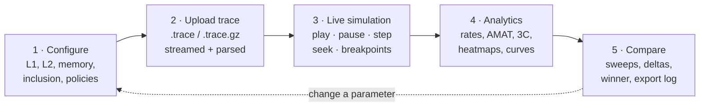

The design rests on one rule, inherited from the original technical design: **the frontend never simulates.** It decodes no address, decides no hit, and picks no victim. The C++ engine is the single source of truth. Everything on screen is rendered from data the engine emitted.

## 2. Scope

| In scope (v1 website) | Deferred | Out of scope |
|---|---|---|
| L1 + optional L2 + memory | Hardware counter monitoring (`ccsim monitor`, [TECHNICAL_DESIGN 8](TECHNICAL_DESIGN.md#8-hardware-monitoring)): kept in the CLI plan, not on the website | Multicore and coherence (MESI) |
| Size, line, ways, latency per level; memory latency | Advanced policies: tree-PLRU, NRU, SRRIP/BRRIP, LFU, MRU, Clock, Belady OPT ([5.6](#56-replacement-policies)) | TLB and virtual-to-physical translation |
| Inclusive / exclusive / non-inclusive L2 | Prefetchers (next-line, stride), victim cache, write buffer depth | Cycle-accurate pipelines, memory-level parallelism |
| Write-back / write-through, write-allocate / no-write-allocate | Different L1/L2 line sizes | Instruction-fetch traces |
| LRU, FIFO, seeded Random | Saved runs and share links ([4.5](#45-what-a-backend-would-be-for-later)) | Accounts, payments |
| Live step-by-step visualisation | Trace importers (Valgrind Lackey, Dinero) | |
| Analytics, sweeps, A/B comparison, export | Education content (frontend team, later) | |

## 3. System context

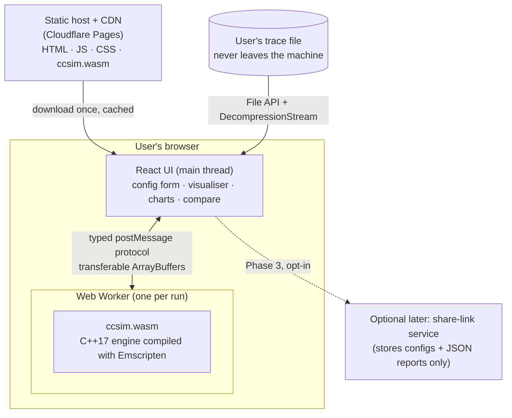

Runtime pieces:

| Piece | Runs where | Responsibility |
|---|---|---|
| **UI** (`web/`, Planned) | Browser main thread | Forms, rendering, animation timing, charts. No cache logic. |
| **Engine worker** (`web/src/engine/`, Planned) | Web Worker | Owns the WASM instance; translates protocol messages into C ABI calls. |
| **ccsim.wasm** (`src/`, Implemented natively, WASM build Not tested) | Inside the worker | Parsing, simulation, events, analytics, comparison. |
| **ccsim CLI** (`src/main.cpp`) | Developer machines, CI | Same engine natively: golden tests, benchmarks, batch runs. |
| **Static host** | CDN edge | Serves the built site. No compute. |

## 4. The API decision: WebAssembly in a Web Worker, not FastAPI

### 4.1 The question

The site will be deployed publicly. The engine is C++. There are two serious ways to put it behind a website:

- **A. Client-side:** compile the engine to WebAssembly and run it in a Web Worker in each visitor's browser. The "API" is a typed message protocol between the UI thread and the worker ([section 8](#8-the-engine-api)).
- **B. Server-side:** a FastAPI (Python) service wraps the engine (pybind11 or a subprocess). The browser uploads the trace and receives events over a WebSocket.

### 4.2 Decision

**A: WebAssembly in a Web Worker,** served from a static CDN. FastAPI isn't used for simulation. If the product later needs server-side persistence (saved runs, share links), that is a small separate service that never runs the simulator ([4.5](#45-what-a-backend-would-be-for-later)).

### 4.3 Why, with numbers

These figures come from this repository's own measurements (`tests/results/benchmark_report.md`, standard dataset, 4,051,312 accesses, native Release build):

| Concern | A: WASM in a worker | B: FastAPI + WebSocket |
|---|---|---|
| **Live stepping latency** | Function call inside the worker, then one `postMessage` per animation frame: well under 1 ms | One network round trip per step or batch: 20 to 150 ms on real networks, and visible jitter while animating |
| **Event volume** | Events are written into a `Uint32Array` that is transferred zero-copy. Measured 24 M events/s natively. | A full live run of the standard trace sends 4 M events, about 300 to 500 MB as JSON. Even binary framing needs a long-lived socket per viewer. |
| **Trace upload** | None. The 58 MB trace is read and decompressed locally (1.2 MB gzip). | Every run uploads up to tens of MB. Needs request size limits, temp storage and clean-up. |
| **Server cost at scale** | $0 compute. Static bandwidth only, about 1 MB of WASM per first visit, then cached. | CPU-seconds per run per user. A comparison sweep of 50 configs is about 50 full simulations on our servers, so cost grows linearly with usage. |
| **Scaling** | Every visitor brings their own CPU. Comparison sweeps can use several workers in parallel on the visitor's cores. | Autoscaling, queues, concurrency limits, cold starts |
| **Abuse surface** | None server-side: nothing to DoS except a CDN | Public upload plus a CPU-heavy endpoint is a ready-made DoS target, so it needs auth or rate limiting |
| **Privacy** | Traces can contain address layouts of proprietary programs, and they never leave the machine | Traces are stored on our server, at least transiently |
| **Single source of truth** | The same C++ code runs in the CLI, CTest and the browser. Goldens test exactly what users run. | C++ plus a Python binding layer that can drift and needs its own tests |
| **Determinism** | Integer-exact results. Same seed gives the same output in every browser (no platform RNG, [5.6](#56-replacement-policies)). | Same, but only on the server's build |
| **Offline / outage** | Works once loaded, even if the host is degraded | Down when the API is down |
| **Toolchain cost** | Emscripten in CI; 64-bit values need BigInt in JS | Python service, container, hosting, monitoring, on-call |

The decisive points are latency and event volume for the live visualiser, and cost and abuse at scale for a public site. Stage 3 is the product's centrepiece, and only option A makes it smooth.

### 4.4 Costs we accept, and their mitigations

| Cost | Mitigation |
|---|---|
| WASM runs slower than native, typically 1.5 to 3× | The native engine runs at about 87 M accesses/s. Even 3× slower, the standard trace finishes in about 0.15 s. |
| The `wasm32` heap is capped at 4 GiB | The trace costs 8.4 bytes per access, so 4 M accesses use 32.5 MiB. The upload limit defaults to 50 M accesses (about 420 MiB) through `max_accesses`. A streaming mode with no stored trace is a later option ([17](#17-roadmap-and-open-decisions)). |
| JavaScript numbers lose precision above 2^53 | 64-bit addresses, lines, fingerprints and the seed cross as BigInt (`-sWASM_BIGINT`) or as `"0x…"` strings in JSON (`seed_hex` next to `seed`). Counters stay ordinary numbers. |
| Emscripten adds a CI toolchain | The engine build is pinned in CI. The same code is always also tested natively. |
| Slow devices | Simulation runs in a worker, so the UI never freezes. Turbo mode skips per-event rendering ([7.4](#74-playback-model)). |

### 4.5 What a backend would be for (later)

Only these features would need a server, and none of them touches the simulation hot path:

- **Share links:** store `{config, trace fingerprint, report JSON}` and return a short id. The recipient re-runs locally if they have the trace, or views the stored report.
- **Saved experiment history** per user.

If we build these, the recommended shape is a few serverless functions on the same platform as the static host (for example Cloudflare Workers with D1/R2), because they deploy alongside the site. **FastAPI is a valid alternative if the team prefers Python**: the traffic is small JSON CRUD and the choice is no longer performance-critical. Either way it is Phase 3 and needs its own design note.

## 5. The cache model

This is the normative behaviour. [TECHNICAL_DESIGN.md sections 3 to 6](TECHNICAL_DESIGN.md#3-cache-configuration) hold the v1 rules; contract extension 1.1 below adds inclusion and write policies. With every extension field at its default, results are bit-identical to v1. That is enforced by the golden tests.

### 5.1 Configuration surface

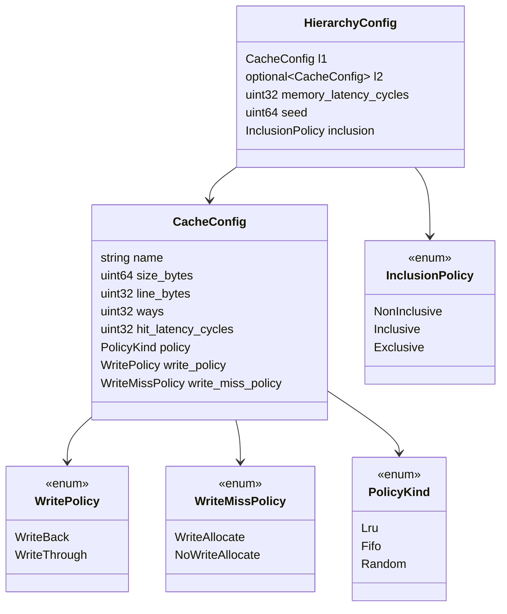

| Parameter | Level | Values | Rule | Default (teaching) |
|---|---|---|---|---|
| `size_bytes` | each | bytes (UI: KiB/MiB) | divisible by `line × ways` | L1 32 KiB, L2 256 KiB |
| `line_bytes` | each | power of two | L1 = L2 in v1 | 64 |
| `ways` | each | ≥ 1; 1 = direct-mapped; `size/line` = fully associative | derived `sets = size / (line × ways)` must be a power of two | 8 |
| `hit_latency_cycles` | each | ≥ 1 | worst case per access `t1 + t2 + tmem` ≤ 2^32 − 1 | L1 4, L2 12 |
| `policy` | each | `lru`, `fifo`, `random` (more Planned) | | `lru` |
| `write_policy` | each | `write_back`, `write_through` | | `write_back` |
| `write_miss_policy` | each | `write_allocate`, `no_write_allocate` | applies to demand stores, so effectively L1 | `write_allocate` |
| `memory_latency_cycles` | hierarchy | ≥ 1 | | 200 |
| `inclusion` | hierarchy | `non_inclusive`, `inclusive`, `exclusive` | ignored without L2 | `non_inclusive` |
| `seed` | hierarchy | uint64 | Random only; L1 uses `seed`, L2 uses `seed + 1` | 1 |

Two layers enforce the rules. In the engine, `Geometry::from()` rejects anything that would break address arithmetic, and `Hierarchy::check()` adds the hierarchy-wide rules (memory latency ≥ 1, equal line sizes, a per-access latency that fits 32 bits); both throw `ConfigError` naming the field, and sweeps use `Hierarchy::check()` to list rejected combinations. `validate()` (configuration track, Planned) is the complete user-facing rule set, and adds friendly warnings such as "an inclusive L2 smaller than L1 back-invalidates constantly". The UI calls `validate()` live as the user types.

### 5.2 Contract extension 1.1

Appended to `include/ccsim/sim/types.hpp` without reordering anything, so existing code keeps compiling:

| Addition | Where | Default = v1 behaviour |
|---|---|---|
| `kPolicyKindCount`, `kPolicyKindNames[]` | after `PolicyKind` | the single policy table (`lru`, `fifo`, `random`) |
| `enum InclusionPolicy`, `enum WritePolicy`, `enum WriteMissPolicy` | after `PolicyKind` | |
| `CacheConfig::write_policy`, `CacheConfig::write_miss_policy` | end of struct | `WriteBack`, `WriteAllocate` |
| `HierarchyConfig::inclusion` | end of struct | `NonInclusive` |
| `LevelStats::no_allocate_misses`, `write_throughs_sent`, `write_throughs_received`, `back_invalidations`, `victims_received` | end of struct | all stay 0 under defaults |

### 5.3 Order of operations

Address mapping is unchanged ([TECHNICAL_DESIGN 4](TECHNICAL_DESIGN.md#4-address-mapping)): `line = addr >> log2(line)`, `set = line & (sets-1)`, `tag = line >> log2(sets)`.

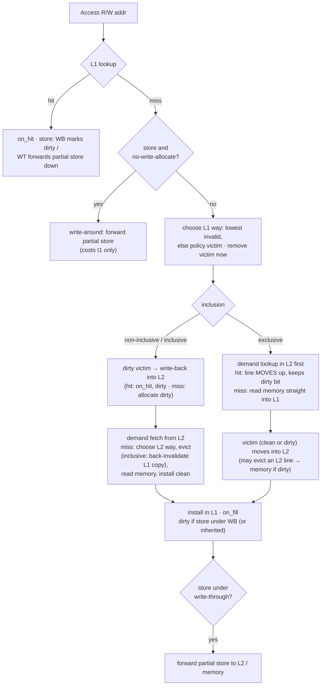

Precise rules, all covered by `tests/unit/test_hierarchy.cpp` and by the differential oracle `tests/stress/test_differential.cpp` (an independent model fuzzed against the engine):

1. **Victims are removed when chosen**, before anything else happens, so an inclusive back-invalidation can never find and double-count the line being replaced.
2. **Non-inclusive / inclusive:** a dirty L1 victim is written into L2 **before** the demand fetch (normative; Demo B step 4 depends on it).
3. **Inclusive:** when L2 evicts a line, the L1 copy (if any) is invalidated (`L1.back_invalidations`). If either copy is dirty there is exactly **one** memory write, counted as an L2 write-back. A back-invalidation is not an L1 eviction.
4. **Exclusive:** the demand lookup happens **first** (a hit frees an L2 slot), then the L1 victim moves into L2 (`victims_received`; dirty ones also count as `writebacks_received`). An L2 hit moves the line up and does not touch L2's replacement state. A memory fill goes straight into L1.
5. **Partial stores** (write-through or write-around) update a lower level only if the line is resident there. Under write-back that marks the line dirty; under write-through the store continues down. They **never allocate** below L1.
6. **Dirty data can travel under write-through.** In exclusive mode a dirty L2 line that moves up keeps its dirty bit even in a write-through L1, so its data is never lost.
7. **Latency (additive, serial):** hit `t1`; L1 miss and L2 hit `t1 + t2`; L2 miss `t1 + t2 + tmem`; no L2 `t1 + tmem`; write-around miss `t1` (the store is buffered); write-backs and forwarded stores cost 0 (buffered).
8. **No flush at end of trace.** Dirty lines still resident are not written back or counted.
9. **Replacement state.** A demand hit, a write-back that hits L2 and a partial store that hits L2 each count as a use (`on_hit`); every install calls `on_fill`. An exclusive L2 hit is not a use (rule 4), and lines removed by back-invalidation or move-out get no separate call: the slot is refilled through `on_fill`.

### 5.4 Invariants (checked on every run in tests)

| Invariant | Holds for |
|---|---|
| `hits + misses = accesses`; `reads + writes = accesses` (L1); `read_misses + write_misses = misses` | every level |
| `evictions ≤ misses − no_allocate_misses`; `writebacks ≤ evictions` | L1 |
| `L2.accesses = L1.misses − L1.no_allocate_misses`, and all L2 demand accesses are reads | with L2 |
| `L2.writebacks_received = L1.writebacks`; `L2.write_throughs_received = L1.write_throughs_sent` | with L2 |
| `memory.reads = L2.misses`; `memory.writes = L2.writebacks + L2.write_throughs_sent` | with L2 |
| `memory.reads = L1 allocating misses`; `memory.writes = L1.writebacks + L1.write_throughs_sent` | no L2 |
| `total_latency = t1·L1.accesses + t2·L2.accesses + tmem·memory.reads` (exact) | every run |
| inclusive: `L2.writeback_misses = 0`; exclusive: `L2.victims_received = L1.evictions`, `L2.writeback_hits = 0`; non-inclusive: no back-invalidations | per mode |
| 3C: `compulsory + capacity + conflict = misses` | every level |

### 5.5 Statistics and AMAT

AMAT = `total_latency_cycles / L1.accesses`: one correctly rounded division of two exact integers, so it is bit-identical in every browser. The textbook formula `t1 + m1(t2 + m2·tmem)` is reported alongside as `amat_textbook_cycles`, and agrees within 1e-9.

### 5.6 Replacement policies

The engine depends only on the `ReplacementPolicy` interface (`on_hit`, `on_fill`, `select_victim`) and a `PolicyFactory` with `make_policy`'s signature. `select_victim` is called only on full sets and must return a way in `[0, ways)`; the engine throws otherwise. When the policy is notified is fixed by [5.3 rule 9](#53-order-of-operations). The production policies are owned by the configuration track. Tests also run the engine against reference stand-ins in `tests/support/`, which can never be linked into the product.

| Policy | Status | Notes |
|---|---|---|
| LRU, FIFO, Random | **Implemented** (config track, `src/policy/`, PR #4); the test stand-ins stay as an independent check | Random: `std::mt19937_64`, `rng() % ways`; never `uniform_int_distribution` |
| Tree-PLRU, NRU (bit-PLRU), MRU, LFU, Clock, SRRIP/BRRIP, LIP/BIP | Planned | Fit the existing interface. Each adds one `PolicyKind` value (appended) and one file under `src/policy/`. |
| Belady OPT | Planned | Needs future knowledge, so it does **not** fit the interface. Proposal: the session precomputes each access's next-use index (one backward pass, O(N) time and 8 bytes per access) and hands it to an `OptPolicy` through a factory parameter. Requires a contract change agreed by both tracks. |

Adding a policy touches only the configuration track's files plus one append in the shared contract: the new `PolicyKind` value, and its name appended to `kPolicyKindNames` with `kPolicyKindCount` bumped (`types.hpp`). JSON, comparison, the WASM decoder and the UI all read that table, so no simulation-track file changes.

## 6. Stage 2: trace upload and parsing

**Status: Implemented** (engine side, `include/ccsim/io/trace.hpp`). The browser glue is Planned.

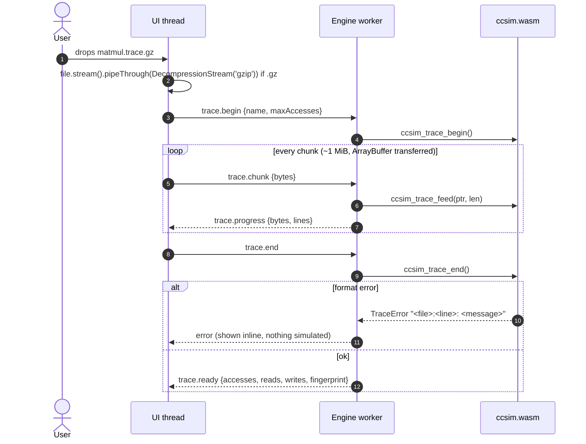

Design choices:

- **Push parser.** `TraceParser::feed(chunk)` parses complete lines in place and keeps only the unfinished tail of the last line. Memory is O(chunk), never O(file). Chunk boundaries cannot change the result (tested at every boundary).
- **Grammar** is format v1, unchanged: `R|W 0x<1-16 hex>`, `#` comments, blank lines, LF/CRLF. Errors are `<source>:<line>: <message>` and stop the upload.
- **Line length:** a line may be at most 4,096 bytes (`kMaxTraceLineBytes`, comments included). The parser rejects a longer line while it is still arriving, so input without line breaks (a binary file, say) cannot grow the carried-over tail until the WASM heap runs out.
- **Storage** is struct-of-arrays: `uint64` address plus one bit for R/W, so **8.4 bytes per access** against 16 for an array of structs. The `Trace` is immutable after loading and shared by every session through `shared_ptr`, so comparing 10 configurations doesn't copy it 10 times.
- **Fingerprint:** a running FNV-1a 64 over the records identifies the trace content. Comparisons refuse to call two runs "the same trace" unless the fingerprints match.
- **Limits:** `max_accesses` (UI default 50 M) gives a clear error instead of exhausting the WASM heap.
- **gzip** is decompressed by the browser's native `DecompressionStream`, so no zlib is compiled into the WASM. Natively, only the tests use zlib, to read the standard dataset.

## 7. Stage 3: the live simulation

**Status: engine Implemented** (`include/ccsim/session/session.hpp`, `include/ccsim/sim/events.hpp`). The UI is Planned.

### 7.1 Session

A `Session` = one `Hierarchy` + online analytics (3C classifiers, timeline) + a cursor into the shared trace.

| Operation | Meaning | Cost |
|---|---|---|
| `step(n, events?)` | execute the next `n` accesses, optionally recording one event each | O(n · ways) |
| `run(max, breakpoints, &last)` | run until a breakpoint fires, `max` accesses, or the end | O(k · ways) for the k accesses executed |
| `seek(pos)` | forward: run silently. Backward: `reset()` then replay silently. | O(pos) worst case, at about 50 M accesses/s natively |
| `reset()` | empty caches, zero counters | O(cache lines) |
| `report()` | full analytics snapshot, also valid mid-run (`complete: false`) | O(sets) |

Why replay instead of checkpoints for backward seeks: cache state cannot be reversed (an eviction destroys information), and checkpointing would need a `clone()` on every policy (a contract change) plus memory per checkpoint. Replaying the entire 4 M-access standard trace takes about 0.08 s natively, faster than a user can drag a slider. If traces ever grow 100× larger, periodic checkpoints are the planned upgrade ([17](#17-roadmap-and-open-decisions)).

### 7.2 What an event contains

Each access produces one fixed-size `AccessEvent` (no heap allocation): sequence number, op, address, line, byte offset, the L1 and L2 views (outcome, set, tag, way), latency, and an **ordered action log** of up to 24 micro-steps:

| Action | Meaning | Flags |
|---|---|---|
| `lookup` | demand lookup at a level | `hit` |
| `evict` | victim removed from (set, way) | `dirty`, `from_policy` (false = filled an invalid way) |
| `fill` | line installed at (set, way) | `dirty` |
| `writeback` | dirty full line arrives at L2 | `hit` (already resident) |
| `write_through` | partial store arrives at L2 | `hit` |
| `back_invalidate` | inclusive: L1 copy removed because L2 evicted it | `dirty` |
| `move_out` | exclusive: line leaves L2 for L1 | `dirty` |
| `victim_insert` | exclusive: L1 victim arrives in L2 | `dirty` |
| `memory_read` / `memory_write` | DRAM traffic | |

Example: Demo B step 4 (`R 0x080`) produces `lookup L1 miss → evict L1 line 0 (dirty) → writeback L2 hit → lookup L2 miss → evict L2 line 4 → memory_read → fill L2 → fill L1`, with 111 cycles. The UI animates those actions in order, and that is how it shows "the request goes down, the dirty victim goes down first, the line comes back up" without knowing any cache rules.

### 7.3 What the visualiser shows (UI contract)

| Surface | Fed by |
|---|---|
| **Address inspector**: tag / index / offset bit fields | `l1.tag`, `l1.set`, `offset` and the geometry bit widths |
| **Set × way grids** for L1 and L2: valid, clean, dirty, plus highlights for hit / fill / evict | `actions[*].set/way`; full redraws from `slot_states` + `slot_tags` after a seek |
| **Hierarchy path**: L1 → L2 → memory, with the levels actually consulted lit | `l1.outcome`, `l2.outcome`, `memory_*` actions |
| **Decision panel**: "L1 miss in set 45; way 3 was LRU; dirty → written back" | the action list plus the configured policy name |
| **Live counters and sparklines** | running totals in the UI, which must equal `report()` at any pause (tested engine-side) |
| **Execution trace list**: click to seek | `seq`, `op`, `address` |

Each level has one look on every page (Home, Learn, Visualize, the live comparison). **L1** is the sorting case: DOM cubbies and envelopes that animate each action, rendering only the rows in view, so a large L1 costs the same as a small one. **L2** is a `<canvas>` grid at any size (a 2 MiB 8-way L2 with 64-byte lines has 4,096 sets × 8 = 32,768 cells), drawing only the rows in view and folding sets together only when a cache is too tall to scroll; the Visualize page lists the accessed L2 set as a table as well.

### 7.4 Playback model

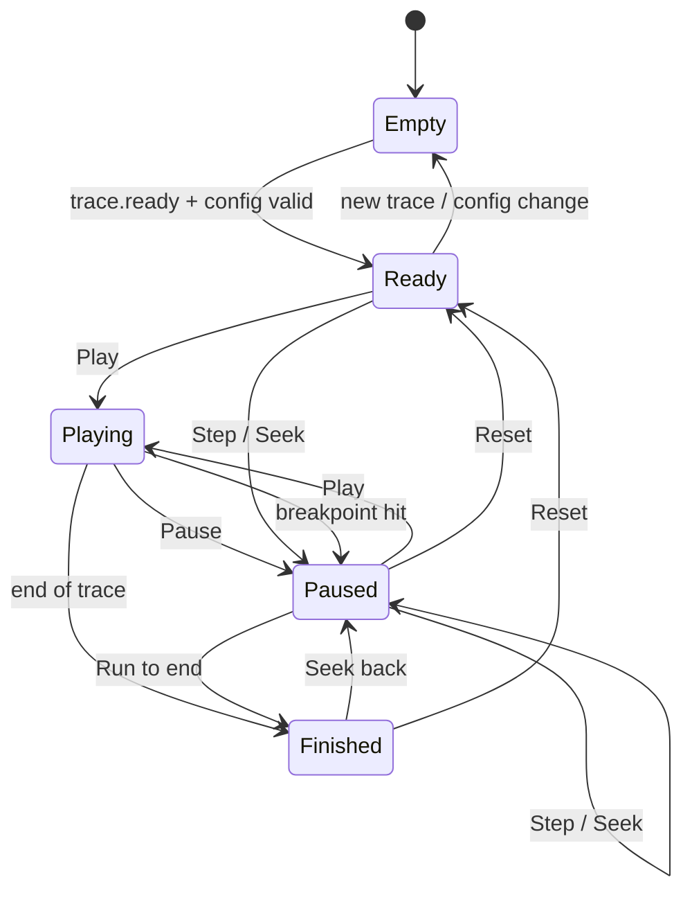

Speed lives entirely in the UI. The engine has no clock.

| Speed mode | Accesses per animation frame | Rendering |
|---|---|---|
| Animated (0.5 to 10 accesses/s) | 1 every N frames | every action animated |
| Fast (up to about 6,000/s) | k = speed / 60 | grid highlights only, no per-action tweening |
| Turbo | `run()` without events in about 1 M-access slices | counters and grid redrawn from snapshots once per frame |

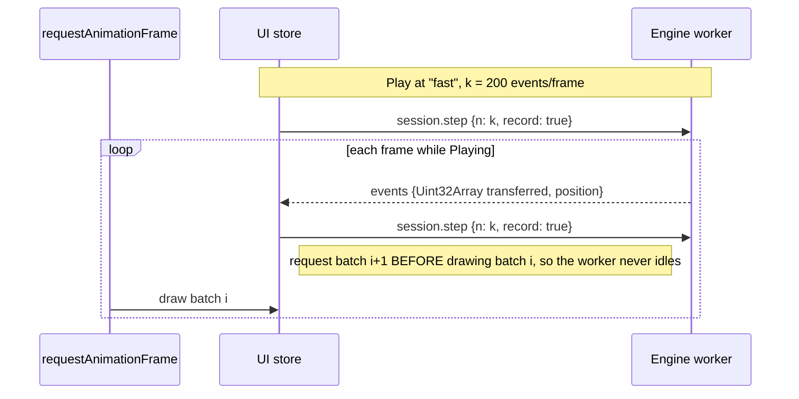

Breakpoints (`Breakpoints` mask, which can be combined): L1 miss, L2 miss, any memory access, any eviction, any dirty write-back, any back-invalidation, and access to a specific cache line.

## 8. The engine API

There are two layers. The **C ABI** (`include/ccsim/wasm/ccsim_api.h`, Implemented and tested natively) is what the WASM module exports. The **worker protocol** (`web/src/engine/protocol.ts`, Planned) is what UI code uses, so UI code never touches WASM memory.

### 8.1 C ABI (exported by `ccsim.wasm`)

| Function | Purpose |
|---|---|
| `ccsim_trace_begin(name, max)` / `_feed(h, ptr, len)` / `_end(h)` | stream a trace in; returns a handle |
| `ccsim_trace_size(h)`, `ccsim_trace_fingerprint(h)`, `ccsim_trace_release(h)` | inspect / free; sessions keep their own reference |
| `ccsim_session_create(trace, cfg[19], 19, flags)` | build a session from the flat config array (layout in the header); flag bit 0 disables 3C. Refuses a configuration whose totals on this trace could pass 2^53 (cycles, or memory bytes at up to 4 lines per access), since JSON numbers above that lose precision in JavaScript |
| `ccsim_session_step(s, n, record)` | step; events encoded into the shared event buffer |
| `ccsim_session_run(s, max, mask, line)` | run to a breakpoint; returns 0 budget / 1 breakpoint / 2 end |
| `ccsim_session_seek`, `_reset`, `_position`, `_release` | cursor control |
| `ccsim_event_buffer()`, `ccsim_event_buffer_words()` | zero-copy view of the last batch (20 header words + 5 per action) |
| `ccsim_session_slot_states(s, level)`, `_slot_tags(s, level)` | grid snapshot after seeks |
| `ccsim_session_report_json(s, label, with_reuse)` | `ccsim.simulation/1` document. The reuse profile describes the whole trace, so it is included only in a complete report (`"reuse": null` mid-run), and is computed once per trace and line size |
| `ccsim_compare_json(sessions, n, labels)`, `ccsim_compare_csv(...)` | `ccsim.comparison/1` document / CSV |
| `ccsim_last_error()` | message for the last failing call. Exceptions never cross the ABI. |

Handles are never reused: after `_release`, the handle stays invalid for the life of the module, so a stale handle held by JavaScript fails with "invalid handle" instead of reaching a newer trace or session.

Why a flat integer config and binary events instead of JSON everywhere: the config is 19 numbers, so there's no parser to get wrong and no allocation. Events are the hot path, so JSON would cost about 10× in size and parse time. Reports and comparisons are produced once per run, so they are JSON for convenience.

### 8.2 Worker protocol (UI ⇄ worker)

```ts
// web/src/engine/protocol.ts (Planned): the only API UI code uses.
type ToEngine =
  | { t: "trace.begin"; name: string; maxAccesses: number }
  | { t: "trace.chunk"; bytes: ArrayBuffer }                 // transferred
  | { t: "trace.end" }
  | { t: "session.create"; id: string; config: HierarchyConfigJS; classify: boolean }
  | { t: "session.step"; id: string; n: number; record: boolean }
  | { t: "session.run"; id: string; maxSteps: number; breakOn: BreakOn[]; line?: bigint }
  | { t: "session.seek"; id: string; position: number }
  | { t: "session.reset"; id: string }
  | { t: "session.grid"; id: string; level: 0 | 1 }
  | { t: "session.report"; id: string; label: string; withReuse: boolean }
  | { t: "compare"; ids: string[]; labels: string[]; format: "json" | "csv" };

type FromEngine =
  | { t: "trace.progress"; bytes: number; lines: number }
  | { t: "trace.ready"; accesses: number; reads: number; writes: number; fingerprint: string }
  | { t: "events"; id: string; words: Uint32Array; position: number }      // transferred
  | { t: "stopped"; id: string; reason: "budget" | "breakpoint" | "end"; words: Uint32Array }
  | { t: "grid"; id: string; level: 0 | 1; states: Uint8Array; tags: BigUint64Array }
  | { t: "report"; id: string; json: string }
  | { t: "compare"; json?: string; csv?: string }
  | { t: "error"; request: ToEngine["t"]; message: string };
```

Concurrency: **one worker per session** for comparisons, so N configurations run in parallel on N cores. Each worker gets the trace bytes once; a later optimisation is to put the `Trace` arrays in a `SharedArrayBuffer`, which requires COOP/COEP headers.

## 9. Stage 4: analytics

**Status: Implemented** in the engine (`include/ccsim/analytics/`). Charts are Planned (frontend).

Every value comes from exact integer counters. A rate with a zero denominator is `null` in JSON and "n/a" on screen, never 0 or NaN.

### 9.1 Metric catalogue

| Group | Metric (JSON key) | Definition | Chart |
|---|---|---|---|
| Headline | `amat_cycles` | total latency / L1 accesses | KPI tile |
| | `speedup_vs_memory` | memory latency / AMAT: what the caches buy | KPI tile |
| | `latency_breakdown.{l1,l2,memory}_cycles` | exact split of total latency (sums to total) | stacked bar |
| Per level | `hit_rate`, `miss_rate` | hits or misses / accesses | KPI + grouped bar |
| | `read_miss_rate`, `write_miss_rate` | per access type | grouped bar |
| | `local_miss_rate`, `global_miss_rate` | L2 misses / L2 accesses, L2 misses / L1 accesses | tiles |
| | `misses_per_kilo_access` | misses per 1,000 L1 accesses (MPKI needs instruction counts, which traces don't have) | tile |
| | `eviction_rate`, `dirty_eviction_ratio` | evictions / accesses, write-backs / evictions | bars |
| | `three_c.{compulsory,capacity,conflict}` | 3C classification ([9.2](#92-how-the-advanced-metrics-are-computed)) | stacked bar |
| | `back_invalidations`, `victims_received`, `write_throughs_*`, `no_allocate_misses` | policy-specific traffic | table |
| Spatial | `set_heatmap.{accesses,misses}` | per set, binned to ≤ 1,024 bins | heatmap |
| | `set_heatmap.access_cv`, `max_to_mean_access`, `untouched_sets` | set balance | tiles |
| Temporal | `timeline.rows` | cumulative counters at about 512 points | miss rate over time (line), warm-up |
| Workload | `reuse.histogram` | reuse distance histogram, log₂ buckets | histogram |
| | `reuse.fa_lru_miss_ratio[k]` | exact FA-LRU miss ratio at 2^k lines | **miss-ratio curve** (what-if capacity) |
| | `reuse.cold`, `footprint_bytes` | distinct lines touched | tile |
| Memory | `memory.{reads,writes,read_bytes,write_bytes,bytes_per_access}` | bus traffic (line-granular) | bars |

### 9.2 How the advanced metrics are computed

- **3C classification** (Hill & Smith). For each level the session keeps a fully associative LRU shadow of the same capacity and a set of seen lines. A real miss to an unseen line is compulsory; a miss the shadow would have hit is conflict; any other miss is capacity. When the real cache beats FA-LRU (possible with LRU on cyclic patterns), the hit is counted under `shadow_only_misses` instead of producing a negative class. Cost: O(1) per access, memory O(distinct lines). An **exclusive L2** gets no classification (`three_c: null`, "n/a" on screen): it holds only L1 victims, never the lines its demand lookups miss on, so a shadow fed with those lookups does not model it and its capacity/conflict split would be invented.
- **Reuse distance / miss-ratio curve** (Mattson stack algorithm). Each line's last-use timestamp is marked in a Fenwick tree. The distance is the number of live marks after it, read with one prefix query, so O(log U) per access. Timestamps are compacted when they run out, so memory is O(distinct lines), not O(trace length). One pass gives the exact FA-LRU miss count for **every** capacity at once. Verified against an O(N²) brute force and two independent FA-LRU implementations.
- **Timeline:** cumulative counters sampled every ⌈N/512⌉ accesses. Constant memory, and gives miss rate over time, warm-up and phase changes.

## 10. Stage 5: comparison and benchmarking

**Status: Implemented** in the engine (`include/ccsim/compare/compare.hpp`). The UI is Planned.

- **Sweeps:** `expand_sweep(base, axes)` takes the cartesian product over L1/L2 size, ways, policy, write policy, write-miss policy, latencies, line size, inclusion, memory latency and seed. Invalid combinations (such as 3-way at 4 KiB, which gives a non-power-of-two set count) are **listed as rejected with the reason**, never silently dropped. The default cap is 256 configurations.
- **Fairness:** every run in a comparison uses the same `Trace` (checked by fingerprint, `same_trace`). The engine is deterministic, so a delta is exact. There is no noise to run significance tests against. For Random policies the seed is part of the configuration.
- **Output** (`compare_runs`): for each of 19 metrics, the value per run, the absolute and relative delta against run 0 (baseline), and the winner, using "lower is better" or "higher is better" per metric. When two or more runs share the best value there is no winner: `best` is null and `tie` is true in JSON, and the CSV and log say `tie`. Also a human-readable list of configuration differences (`L1.ways: 4 -> 8`).
- **Export:** `ccsim.comparison/1` JSON for charts, CSV for spreadsheets, and a plain-text **benchmark log** containing each run's exact configuration string, so any result can be reproduced. A live sample is [tests/results/standard_dataset_report.md](../tests/results/standard_dataset_report.md).
- **Charts:** a grouped bar per metric (one bar per configuration, colour fixed per configuration), a line chart for sweeps (x = swept parameter), miss-ratio curves overlaid, and a delta table with the winner highlighted. Metrics with different units never share an axis.

## 11. Repository structure and layering

```text
CacheSim/
├── AGENTS.md                  operating manual for AI agents and new contributors
├── README.md  CONTRIBUTING.md
├── QA_REPORT.md               repository QA report (test completion report, kept current)
├── CMakeLists.txt             root: options + auto-discovers src/*/CMakeLists.txt (rarely edited)
├── docs/                      ARCHITECTURE (this) · TECHNICAL_DESIGN · FRONTEND_DESIGN · WORKING_DEMO · DEVELOPMENT · OVERVIEW
├── assets/images/             UI mood-board screenshots
├── include/ccsim/             public headers, one folder per module
│   ├── sim/types.hpp          SHARED CONTRACT (config + stats): append-only
│   ├── policy/                config track: ReplacementPolicy, make_policy
│   ├── config/                config track (Planned): validate(), spec parsing, presets
│   ├── io/                    simulation track: trace format v1 parser + Trace storage
│   ├── sim/                   simulation track: geometry, line_index, cache_level, events, hierarchy
│   ├── analytics/             simulation track: metrics, 3C, reuse distance
│   ├── session/               simulation track: live controller, batch runner
│   ├── report/                simulation track: JSON (results, events)
│   ├── compare/               simulation track: sweeps, comparison, logs
│   └── wasm/                  simulation track: C ABI for the browser
├── src/<module>/              implementation + that module's CMakeLists.txt
│   └── cli.cpp, main.cpp      CLI shell
├── tests/
│   ├── CMakeLists.txt         suites discovered by glob
│   ├── support/               harness, fixtures, reference policies (TEST-ONLY)
│   ├── smoke/ unit/ golden/ stress/ dataset/ bench/
│   ├── data/golden/           Demo A–C traces (hand-derived expectations)
│   ├── data/standard/         THE standard dataset + manifest
│   └── results/               generated evidence (curated files committed)
└── web/                       frontend (Planned, frontend track)
```

Dependency direction (an arrow means "may include"). There are no cycles, and nothing below `wasm` knows the browser exists:

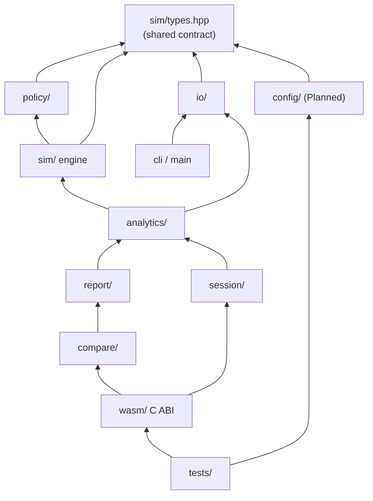

Design rules (carried over from [TECHNICAL_DESIGN 2](TECHNICAL_DESIGN.md#2-architecture), plus additions):

1. `src/{io,sim,policy,config,analytics,session,report,compare}` are ISO C++17 only: no OS headers, threads, clocks, or global mutable state. Only `src/wasm/` (the ABI boundary) and the CLI keep process-level state.
2. Every capability is a library call first. The CLI and the WASM ABI are thin adapters.
3. No third-party dependencies in the engine. zlib is used **only** by tests, to read the gzip dataset.

## 12. Ownership and merge-conflict strategy

### 12.1 Tracks

| Track | Owner | Owns (create and edit freely) |
|---|---|---|
| **Configuration and policies** | teammate (GitHub `Code-r4Life`) | `include/ccsim/policy/`, `src/policy/`, `include/ccsim/config/`, `src/config/`, `tests/unit/test_policy_*.cpp`, `tests/unit/test_config_*.cpp` |
| **Simulation** (trace → engine → live → analytics → compare) | repository owner | `include/ccsim/{io,sim,analytics,session,report,compare,wasm}/` (except `sim/types.hpp`), matching `src/` folders, `tests/` (except files above), `tests/data/standard/` |
| **Frontend** | later | `web/` |
| **Shared: change only by the protocol in 12.3** | both | `include/ccsim/sim/types.hpp`, root `CMakeLists.txt`, `docs/ARCHITECTURE.md`, `AGENTS.md` |

### 12.2 Structural rules that make conflicts unlikely

| Conflict source | Rule |
|---|---|
| Both editing the root `CMakeLists.txt` to add sources | Each module has its **own** `src/<module>/CMakeLists.txt`, and the root discovers them by glob. A new module never touches the root file. |
| Both adding tests to one registration list | Test sources are globbed per suite folder, and each test file self-registers (`TEST_CASE`). One file per module per owner. |
| Both editing `types.hpp` | **Append-only:** new enum values go at the end, new fields at the end of a struct, with defaults that preserve current behaviour. No reordering, renaming, or reformatting. One contract change per PR, labelled `contract`. |
| Engine blocked on unimplemented policies | Engine and tests depend on the interface plus `PolicyFactory`. Stand-ins live in `tests/support/`. When `src/policy/` appears, the build detects it and runs the golden suite against production policies too. Nobody waits. |
| Adding a policy forcing edits in the other track's files | One shared table (`kPolicyKindNames`, `kPolicyKindCount`) next to the enum. Everything else reads it. |
| Line-ending churn (Windows vs Unix) | `.gitattributes`: `* text=auto eol=lf`; binaries (`*.gz`, `*.png`, `*.wasm`) marked binary |
| Formatting churn | No mass reformatting. Match the surrounding style until `.clang-format` lands (M1-03). |
| No integration branch yet (`dev` doesn't exist on the remote) | Until Role 1 creates `dev`, both tracks branch from and PR into `main`. Create `dev` before a third contributor joins. |
| Generated files | Only the curated reports in `tests/results/` are committed, each with exactly one generator. Never hand-edit them. |
| Big docs edited by both | Each track documents its module in its own section or file. Shared docs are edited in small, separate PRs. |
| Long-lived branches | Short `feat/<area>-<topic>` branches. Rebase on `main` (or `dev` once it exists) before review. Merge at least weekly. |

### 12.3 Shared-contract protocol

1. Open an issue labelled `contract` describing the append-only change.
2. The other track acknowledges it in the issue (async is fine).
3. One small PR containing only the contract change plus its doc update in this file ([5.2](#52-contract-extension-11)).
4. Both tracks rebase after merge.

Recommended next step for the build owner (Role 10): add `.github/CODEOWNERS` mirroring 12.1, so GitHub requests the right reviewer automatically.

## 13. Performance and complexity

### 13.1 Per-operation cost

| Operation | Time | Extra memory | Notes |
|---|---|---|---|
| Parse | O(bytes) | O(chunk) | in place, no regex, no per-line allocation |
| Store trace | O(1) amortised per access | 8.4 B/access | struct-of-arrays + bitset |
| Lookup, ways ≤ 16 | O(ways) | 0 | contiguous tag scan |
| Lookup, ways > 16 | O(1) expected | 12 B/line + slack | flat open-addressing hash, backward-shift delete (no tombstones) |
| Choose way | O(1) when the set is full; O(ways) scan only while it is filling | 4 B/set | per-set fill counter |
| Policy calls | O(policy) | owner's choice | interface allows O(1) LRU |
| Event recording | O(actions) ≤ 24 | 0 (fixed POD) | batch path pays nothing |
| 3C classification | O(1) expected | O(distinct lines) | FA-LRU shadow + seen set |
| Reuse profile | O(N log U) | O(U) | Fenwick + compaction |
| Timeline | O(1) | O(512 points) | |
| Seek backward | O(target) | 0 | replay |
| Report | O(sets) | O(min(sets, 1024)) | heatmap binned |

### 13.2 Measured (native, GCC 16 `-O3`, one thread; standard dataset, 4.05 M accesses)

| Path | Throughput |
|---|---|
| Batch, default L1+L2 | 86.9 M accesses/s (47 ms) |
| Batch, 512-way fully associative L1 | 79.1 M accesses/s |
| Session with 3C + timeline | 52.2 M accesses/s |
| Stepping with event recording (live UI path) | 24.1 M events/s |
| Exact reuse-distance profile | 25.5 M accesses/s |
| gunzip + parse | 31.5 M accesses/s |
| Memory: trace / session / report JSON | 32.5 MiB / 0.35 MiB / 31 KiB |

The full table, regenerated by `ctest -L bench`, is in [tests/results/benchmark_report.md](../tests/results/benchmark_report.md). WASM numbers are Not tested; expect them to be 1.5 to 3× lower.

## 14. Testing and quality

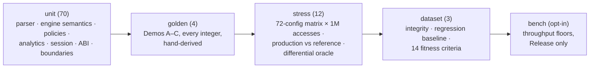

- **Independent oracles:** golden numbers come from hand derivations in [WORKING_DEMO.md](WORKING_DEMO.md), never from this implementation's output. Analytics are cross-checked by independent implementations (brute force, FA-LRU shadow, engine). The engine itself is cross-checked by a second, naive model of section 5.3 fuzzed over 3,000 random configurations (`differential.*`), comparing every counter and every final slot.
- **Regression baselines** for the standard dataset are pinned and labelled as such ([tests/data/standard/README.md](../tests/data/standard/README.md)).
- **Toolchains verified on Linux:** GCC 16 Release, GCC Debug + AddressSanitizer + UBSan, Clang Release, all with `-Werror -Wall -Wextra -Wpedantic -Wshadow -Wconversion`. Windows, macOS and Emscripten are Not tested.
- **Frontend (Planned):** Vitest for protocol decoding and stores; Playwright end-to-end that loads the WASM, runs Demo B, and asserts the grid equals the engine events (AC-11).

## 15. Build, CI and deployment

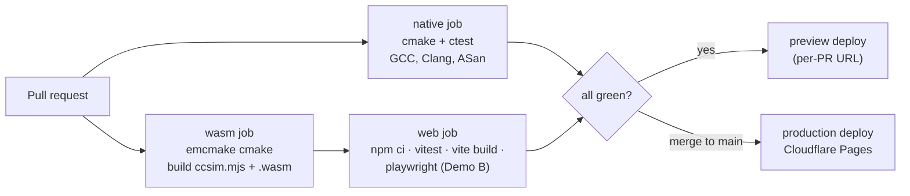

| Item | Choice |
|---|---|
| Engine build | CMake ≥ 3.20 and Ninja; `emcmake cmake -S . -B build-wasm && cmake --build build-wasm` produces `ccsim.mjs` + `ccsim.wasm` (ES module, worker environment, BigInt, memory growth up to 4 GiB) |
| Frontend | React 18 + TypeScript + Vite; state in Zustand; charts in Apache ECharts (canvas: handles 32 K-cell heatmaps and long series); grids on raw `<canvas>` |
| Hosting | Cloudflare Pages: static, global CDN, preview URLs per PR, `_headers` file for caching. GitHub Pages is an acceptable fallback. |
| Headers | `Content-Type: application/wasm` (for streaming compilation), hashed asset names + `Cache-Control: immutable`, strict CSP (`script-src 'self' 'wasm-unsafe-eval'`) |
| Versioning | `ccsim_version` in every JSON document; schemas versioned (`ccsim.simulation/1`, `ccsim.events/1`, `ccsim.comparison/1`); additive changes keep the number |
| Toolchain pins | emsdk version and Node version pinned in CI by the build owner |

## 16. Security and privacy

- **No server-side compute or storage** in v1. Uploaded traces stay in the browser tab.
- Parser hardening: every malformed input is a `TraceError` with a line number, never undefined behaviour (fuzzing is Planned). There's a hard access limit, and all array indices are bounds-checked by construction (the set index is masked; the policy's victim is range-checked).
- The C ABI catches every exception and validates every handle; a bad handle returns an error, never a crash (tested).
- A content-security policy allows only same-origin scripts plus WASM compilation. No third-party scripts or analytics without a privacy review.

## 17. Roadmap and open decisions

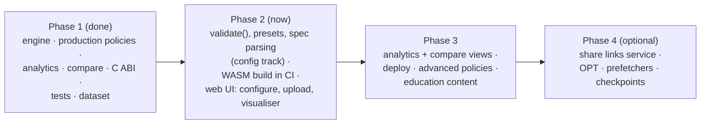

| Open decision | Owner | Default if undecided |
|---|---|---|
| Interface for Belady OPT (next-use hints) | both tracks | Planned contract change ([5.6](#56-replacement-policies)) |
| Checkpoints for backward seeks on very large traces | simulation track | replay (current) |
| Streaming mode for traces over 50 M accesses (re-read from `File`, no stored trace) | simulation track | upload limit |
| Share-link backend: serverless vs FastAPI | project lead | not built |
| Different L1/L2 line sizes | config + simulation | equal (v1) |
| Hardware monitoring on the website | project lead | CLI only, deferred |

## 18. Document map

| Document | Read it for | Status after this revision |
|---|---|---|
| **ARCHITECTURE.md** (this) | the whole system, decisions, ownership | current |
| [TECHNICAL_DESIGN.md](TECHNICAL_DESIGN.md) | exact v1 rules: geometry, trace format, statistics, monitoring design | current for sections 3 to 7 and 9 to 11; deferred parts marked |
| [WORKING_DEMO.md](WORKING_DEMO.md) | hand-checked examples = golden oracle | current |
| [FRONTEND_DESIGN.md](FRONTEND_DESIGN.md) | views, layout, chart rules | current; transport section now points here |
| [DEVELOPMENT.md](DEVELOPMENT.md) | building and testing on each OS | current |
| [OVERVIEW.md](OVERVIEW.md) | a one-page tour | current |
| [../tests/data/standard/README.md](../tests/data/standard/README.md) | the standard dataset | current |
| [../AGENTS.md](../AGENTS.md) | agent and contributor rules | current |
| [../QA_REPORT.md](../QA_REPORT.md) | latest QA pass: methods, results, defects, open risks | current |

## 19. Glossary

| Term | Meaning |
|---|---|
| Line / block | The unit a cache stores (here 16 to 128 bytes); `address >> log2(line)` |
| Set, way | A cache has `sets` rows of `ways` slots; a line can live only in the set its index bits select |
| Direct-mapped / fully associative | 1 way / 1 set |
| Write-back / write-through | Store marks the line dirty / store is forwarded at once |
| Write-allocate / write-around | Store miss fetches the line / store miss bypasses the cache |
| Inclusive / exclusive / NINE | L2 ⊇ L1 / L1 ∩ L2 = ∅ / neither enforced |
| Back-invalidation | Removing an L1 line because an inclusive L2 evicted it |
| AMAT | Average memory access time = total latency / accesses |
| 3C | Compulsory, capacity, conflict miss classes |
| Reuse (stack) distance | Distinct lines touched between two uses of a line |
| MRC | Miss-ratio curve: miss ratio as a function of capacity |
| MPKA | Misses per 1,000 accesses |
| Trace fingerprint | FNV-1a 64 hash of the access records; identifies a trace |
