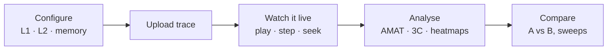
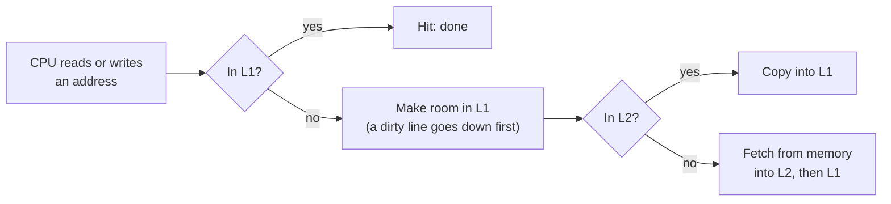
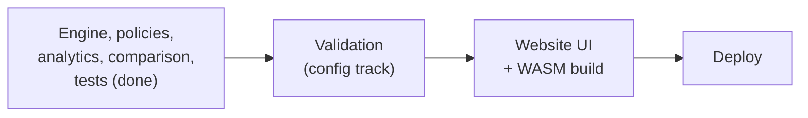

# ccsim at a glance

A website that shows exactly how CPU caches work. You configure a cache hierarchy, upload a memory trace, then watch every access move through L1, L2 and memory, analyse the result, and benchmark configurations against each other. The C++ engine runs **in your browser** (WebAssembly), so traces never leave your machine.



## Why caches matter

| Where the data is | Cost with the default teaching latencies | vs. an L1 hit |
|---|---|---|
| L1 hit | 4 cycles | 1× |
| L2 hit (L1 miss) | 4 + 12 = 16 cycles | 4× |
| Main memory (L1 and L2 miss) | 4 + 12 + 200 = 216 cycles | 54× |

Memory is huge but slow; caches are small and fast. Every miss pushes the request one level further down.

## What happens on every access



Every step is counted (hits, misses, evictions, write-backs) and shown live. Inclusive, exclusive and write-through hierarchies change the details; see [ARCHITECTURE.md section 5.3](ARCHITECTURE.md#53-order-of-operations).

## How the cache finds a line

The default L1 (32 KiB, 64-byte lines, 8 ways → 64 sets) splits an address into three fields:

```text
address 0x7ffd1b64
| tag (upper 52 bits) | set index (6 bits) | byte offset (6 bits) |
                         = 45                 = 36
```

The set index picks one of 64 sets. The line is a hit if one of that set's 8 ways holds a matching tag.

## Who gets evicted when a set is full

| Policy | Evicts |
|---|---|
| LRU | The line unused for the longest time |
| FIFO | The line that arrived first |
| Random | Any line, from a seeded generator, so runs are repeatable |

More policies (PLRU, SRRIP, LFU, Belady's optimal, …) are planned.

## Where we are



Working now (Linux-verified library code with tests): trace parsing, the L1/L2 engine with every inclusion and write policy, the LRU, FIFO and Random replacement policies, the live-session API, analytics, comparison and sweeps, the browser C ABI, and the validated standard dataset. Planned: `validate()`, the `simulate` CLI command, the web UI, and deployment. Hardware monitoring is deferred.

## Go deeper

| Read | For |
|---|---|
| [ARCHITECTURE.md](ARCHITECTURE.md) | **Start here**: the whole system, decisions, ownership |
| [TECHNICAL_DESIGN.md](TECHNICAL_DESIGN.md) | Exact v1 rules, formats, interfaces |
| [WORKING_DEMO.md](WORKING_DEMO.md) | Step-by-step examples with expected results |
| [FRONTEND_DESIGN.md](FRONTEND_DESIGN.md) | The web UI views |
| [DEVELOPMENT.md](DEVELOPMENT.md) | Build and test on your OS |
| [../AGENTS.md](../AGENTS.md) · [../CONTRIBUTING.md](../CONTRIBUTING.md) | How to contribute |
